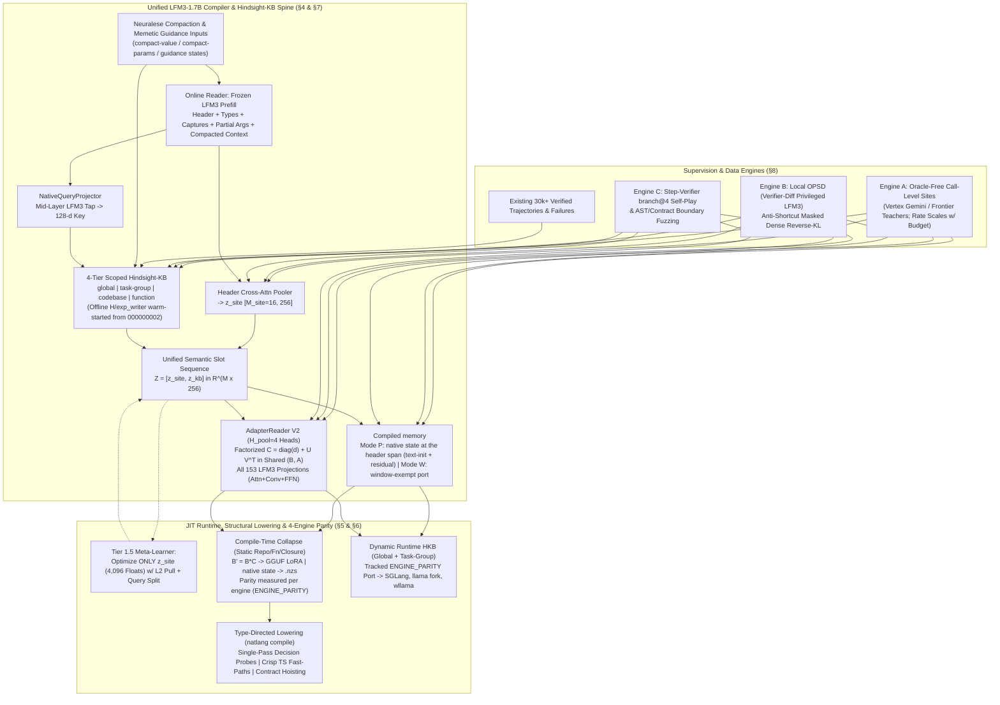

# The Natlang Compiler: Functions into Weights, Experience into Weights, Types into Code

**Status:** Canonical design brief, implementation plan, and training plan (2026-11-25, revised after cross-review)  
**Scope:** Unifies `~/natlang` (`LFM3-1.7B` runtime, compiler, tuning, training) and `~/hindsight-kb` (sparse memory, experience learning, virtual KV bank, dynamic `B C A` adapter synthesis) into one compounding build and training program.

> Owner direction (2026-11-25):
> - *"Since we seem to be struggling a lot with getting the model to measurably improve on just vanilla general capability, I think we should branch out somewhat."*
> - *"Rethink, rework, and update our approach to per function, per code base tuning... come up with a meta-learner that could take a natlang program and perhaps some samples and optimize its parts sample efficiently... playing with the futamura projection or in general just soft prompts, weight space programming and adapters."*
> - *"Leveraging the architecture and perhaps some trained state of `~/hindsight-kb` to train general capability and allow for per task / task group knowledge base tunes."*
> - *"We want to be unreasonably ambitious. And we want to really lean on priors and think closely about what we can prioritize based on our first principles thinking."*

This is a build plan, not a proposal menu. Every component below has an exact implementation seam, training recipe, hardware assignment, and declared success criterion, and enters use as soon as it works (`AGENTS.md`: *"A finding is not done until it is acted on"*; *"Don't measure what first principles already settle"*).

---

## 1. Thesis & First-Principles Diagnosis

**A natlang program is a program, and a 1.7B model is an interpreter for it.**

Vanilla generalist training of `LiquidAI/LFM3-1.7B` via offline SFT + binary-reward GRPO (`aei1`) has hit a structural wall (`plans/neuralese/DECISIONS.md` 2026-11-25 14:20; `plans/neuralese/HELD_FAILURES_20261123.md`):

1. **Interference and capacity wall:** Round 1 of `aei1` gained ~4–5 pp on `held-v3` (19.6M fresh teacher tokens), then rounds 2–10 went statistically flat (SE ~2.3 pp) as fresh teacher supervision collapsed to 1–2.5M tokens/round. Cramming every domain's micro-conventions, rubrics, and error-recovery habits into one static 1.7B weight vector fights scaling laws head-on.
2. **Bit-starved supervision:** Binary-reward GRPO extracts ~1 bit per 20k-token episode. Offline teacher SFT zero-weights teacher reasoning (voice mismatch), leaving ~90 supervised action tokens against ~5,000-token prompts.
3. **Failure profile is specialist, not foundational:** `LFM3-1.7B` already writes valid TypeScript and calls tools. Its top held failures are *program- and domain-specific*: `misread_spec` (43), `tool_idiom` (25), `bypassed_construct` (20), `exploration_loop`/`error_recovery` (25), and `child decision readouts` (29 + 4×4 budget stops).
4. **Unused programming-language leverage:** Natlang is not a chatbot. Every program arrives **pre-decomposed into typed call sites** with lexical scopes, finite decision readouts (`readout: decision`), explicit contracts (`ensures:`, `Is<T, ...>`), `pluggable` crisp/NL duality, partial application (`.partial`, `.in`, `withContext`), Neuralese compaction, and runtime-synthesized closures (`nl\`...\``). Specializing a small model to *one call site* is a dramatically lower-dimensional problem than general capability (on `LFM2.5-350M`, per-program tuning jumped ticket routing from 0/20 → 17/20, `plans/PROGRAM_TUNING_RUNS_20261026.md`; note that `LFM3-1.7B` Tier-2 merged fits currently carry an open regression bug—see §3 & W0.1—and are not trusted until fixed).

### The Core Unification

Stop asking a static 1.7B interpreter to carry everything in base weights. Build **one unified compiler and memory system** with five compounding pillars:

1. **Unified Slot-to-Weights Compiler & Experience Engine (`Z ∈ ℝ^{M×256} → (MemoryKVBank, B C A)`):** Program headers (read online by frozen `LFM3` itself—zero extra online backbone), Neuralese compacted values/memetic guidance states, and retrieved experience records (from `~/hindsight-kb` via `NativeQueryProjector`) all map into **one 256-dim semantic slot space** $Z = [z_{\text{site}}, z_{\text{kb}}]$ feeding **one shared dual head** (`MemoryKVBank` + `AdapterReader` V2). General capability (global/task-group experience KBs) and per-function/codebase tuning become the *runtime* and *compile-time* faces of the exact same network.
2. **Multi-Tier JIT Runtime & Regularized 4K-Param Latent-Manifold Meta-Learner:** Cold sites interpret (Tier 0), warm sites and **runtime-synthesized NL closures** compile in one forward pass (Tier 1), few-shot sites optimize *only* their 16 continuous `256`-dim semantic slots (4,096 floats, regularized with L2 pull toward $z_{\text{site}}^{(0)}$, FO-MAML meta-initialization, and a held-out query split per site; Tier 1.5), and hot sites promote to full tuning (Tier 2). Static compiled releases collapse adapters to a standard GGUF LoRA and memory to an ordinary native state (`.nzs`, spliced at the header's real positions), the two artifacts every engine already serves; end-to-end parity of a compiled release on each engine is measured, not assumed (§4.4, `docs/ENGINE_PARITY.md`). Window-exempt RoPE-free dynamic memory slots are tracked as an explicit 4-engine parity port (§4.4, §10 W4.2).
3. **Type-Directed Structural Lowering & First-Class Judges (2nd Futamura Projection):** Compile `readout: decision` into single-pass calibrated scoring heads (killing 4×4 budget exhaustion), promote deterministic `.nl` leaves into verified `pluggable` crisp TypeScript fast-paths with `escalate` fallback, compile combinator judges (`holds`, `beats`, `settled`, `relates`, `meets`), and hoist `ensures:` contracts into constrained decoding.
4. **Dual Supervision Engine (Call-Level Frontier Scale + Local Privileged Density):** Combine an **Oracle-Free Call-Level Distillation Engine** (scaling across millions of single NL call sites—unblocked today with Vertex Gemini back online, throughput scaling with teacher budget) with **On-Policy Privileged Self-Distillation (OPSD)** (local dense reverse-KL from verifier-diff-conditioned `LFM3` onto unprivileged `LFM3`, with anti-shortcut masking) plus a **Hidden-State Step-Verifier** for prefix-shared `branch@4` search and self-play. Both feed directly into the compiler, judges, experience store, *and* `expert_iteration`'s upgraded SFT mix.
5. **Active 0-to-10-Example Compilation:** Make `natlang tune` effective with almost no user labels via zero-label codebase ingestion, AST/contract boundary fuzzing, `branch@4` consensus pseudo-labels, and active teacher escalation on the top-15 highest-entropy boundary inputs.

---

## 2. The Futamura & Partial-Evaluation Frame, Concretely

| Concept | Classical PL Theory | Natlang Compiler Realization |
|---|---|---|
| **Interpreter** $I(p, x)$ | Runs program $p$ on input $x$ | Frozen `LFM3-1.7B` reading site header $p$ (instructions, types, rubric) and executing on $x$ |
| **1st Futamura Projection** $S(I, p)$ | Specializing $I$ to $p$ yields a compiled executable | Per-site residual $(C_p, \text{KV}_p)$ such that `LFM3` + $(B C_p A, \text{KV}_p)$ runs $p$ at specialist quality (and optionally omits repeated prompt boilerplate) |
| **2nd Futamura Projection** $S(S, I)$ | Specializing the specializer to $I$ yields a compiler | **The Neural Compiler** $C_{\phi}(p) \to z_p \to (B C_p A, \text{KV}_p)$ in one forward pass, *plus* **Type-Directed Structural Lowering** (`decision` → single-pass probe, deterministic `.nl` → `pluggable` crisp TS) |
| **3rd Futamura Projection** $S(S, S)$ | A compiler generator | Self-improving compiler loop: Tier 1.5/2 verified corrections and `branch@4` search wins continually retrain $C_\phi$ across backbones |
| **Static Argument Specialization** | Partial evaluation on known arguments | `.partial(arg)`, `.in(ctx)`, `withContext` fold `arg` into $z_{\text{partial}} \to C_{\text{partial}} + \text{KV}_{\text{partial}}$ once and compose linearly |
| **Deforestation / Fusion** | Fusing producer & consumer | `ts-host/src/fusion/` fuses adjacent `.nl` calls into one compilation unit with one shared compiled adapter & prefix KV |
| **Dynamic Code Generation** | Closures, `eval`, runtime JIT | **Runtime-synthesized NL literals** (`nl\`...\`` with captures; functions returning judgment functions like `scopeJudge`) compiled on creation—real closures in weight space |
| **JIT Tiers** | Interpreter → baseline JIT → optimizing JIT → AOT | Tier 0 (interpret) → Tier 0.5 (primed `.nzs`) → Tier 1 (`C(header)`) → Tier 1.5 (4K-param latent TTT) → Tier 2 (`natlang tune` + GEPA) → Crisp TS fast-path |

---

## 3. Repository Inventory & What Each Piece Becomes

Every component extends existing infrastructure (`AGENTS.md`: *"One implementation per concept"*).

| Existing Asset | Location | Role in the Unified Program |
|---|---|---|
| Per-site LoRA scope tree, per-call stacks, release store, activation/rollback | `ts-host/src/adaptation/weights/` | Canonical weight store for Tier 1, Tier 1.5, Tier 2, and compiled decision releases, keyed by site identity & policy SHA |
| `natlang tune`, incremental builds, families, reward/services hooks | `ts-host/src/tune/`, `training/neuralese/natlang_neuralese/tune/` | **Tier 2** optimizing tuner + **Tier 1.5** latent-TTT host + **Compile-Time Collapse** exporter |
| Persistent site identities & rename migrations | `ts-host/src/tune/sites.ts` | Compiled-adapter & latent-slot cache keys |
| Soft instruction/skill states (`.nzs`, CSPD) | `tune/soft.py`, `tune/soft_export.py`, llama fork `--native-state` | **Tier 0.5** free primed state + exact serving container for positioned pre-RoPE compiled memory (§4.4) |
| Learned compaction operators (`compact-value`, `compact-params`) | `ts-host/src/native/agent.ts`, `model/learned_operators.py`, `DECISIONS.md` 2026-11-25 15:00 | On by default on all four engines (fork release `natlang-b12094`, fork commit `b536c7379`, vendored page `5269b1a5a`; DECISIONS 2026-11-25 15:00, 15:40). An input to the compiler (compacted spans in headers) and to the experience store (compacted records), not only Stage B of retrieval |
| Memetic guidance states (`natlang.memetic-program-guidance/1`) | `ts-host/src/guidance/`, `rl/memetic_program.py`, `rl/memetic_workspace.py` | Memetic learning keeps training (owner 2026-11-18); its guidance states are one input (`z_guidance`) to the shared compiler/writer (§12) |
| Fusion planner | `ts-host/src/fusion/` | Call-graph partial evaluator; fused sites compile as one header unit |
| GEPA instruction search | `ts-host/src/gepa/` | Tier 2 text-edit companion (structural fixes alongside weights) |
| Pluggable crisp/NL interface | `ts-host/src/runtime/pluggable.ts` | Hosts `chooseTier`, `worthTuning`, `whichScopes`, `worthRemembering`, and **promoted crisp fast-paths** |
| Per-sequence LoRA + decision readout serving on all 4 engines | `~/llama.cpp-neuralese`, `ts-host/vendor/wllama`, `serve/sglang_actor.py`, native Python | Serving target for all compiled releases (`POST /v1/natlang/score`, `--lora-per-sequence`, `--native-state`), extended via `docs/ENGINE_PARITY.md` for dynamic HKB |
| Expert-iteration async driver & `sft_sources` | `scripts/neuralese_data/expert_iteration.py`, `sft_sources.py` | Upgraded in place: gains OPSD and Call-Level tiers; time-shared cleanly with Compiler T2 on `colab-g4a` (§9.1) |
| Shared `lora+rows` FP32-master training core | `training/neuralese/natlang_neuralese/train/{lfm3_learner.py,lfm3_fast.py}` | Hosts OPSD (`--opsd`), Step-Verifier head, and compiler/reader gradient passes |
| `LFM3-1.7B` vendored modeling & port | `training/neuralese/natlang_neuralese/model/lfm3_port.py`, `third_party/lfm3` | Exact reference contract for `NativeLFM3Decoder` in `~/hindsight-kb` |
| `~/hindsight-kb` storage, packed IVF-PQ store, dual readers, Live-KB, experience learning | `~/hindsight-kb/src/hindsight_kb/{kb,models,integrations,experience,serving}` | Experience store, `MemoryKVBank`, `AdapterReader` V2, `NativeQueryProjector`, Live-KB trainer, free-record latent optimizer |
| `~/hindsight-kb` salvaged checkpoint `000000002` | `~/hindsight-kb-recovery/2026-10-21/` (36.1 GB `.tar.zst`; 45k updates, 1.02M records) | Warm-start initialization for `pplx-embed` writer `H` & query encoder `Q` (key space transfers well; value head substantially re-fit for LFM3 in T2) |
| Authored programs (28+), `broad-external` (68,887 rows), `git_history` (12k repos) | `scripts/rl_tasks/sources/`, `training/corpora/` | Seeds Call-Level Engine, OPSD pool, Step-Verifier archive, and initial Experience KB |

**Open item (W0.1 — gates Tier 2, not Tier 1/1.5):** `LFM3-1.7B` program-tuning merged arms measured −23 to −78 pts against base on 4 of 6 programs. Cause found (DECISIONS 2026-11-25 17:30): the fits taught the policy to skip its reasoning (own readouts trained `</think>`, fixed in 1ff53eec6; acting at the think tag after empty teacher think blocks). **Program-tuning fits are not trusted teacher targets or baselines until the rerun after the reasoning-loss fix shows them valid.**

---

## 4. The Unified Compiler & Experience Architecture (`Z → MemoryKVBank + AdapterReader V2`)

### 4.1 One Shared Semantic Bottleneck ($Z \in \mathbb{R}^{M \times 256}$)

Program compilation, Neuralese compacted context, memetic guidance states, and retrieved experience all converge onto **one 256-dimensional semantic slot representation** feeding **one** weight+KV writer:

1. **Online Site Header Path (`HeaderEncoder(header) → z_site` — 100% LFM3-only, zero extra online backbone):**
   - **Input (`header`):** Rendered in the real serving call format: resolved instruction text (captures substituted for NL literals), TypeScript signature/types/doc comments/unions/`Is<>`/`ensures:`, caller path & combinator role (`match:`, `check`, `iterateOn` step), bound static arguments (`.partial`/`.in`/`withContext`), any committed **memetic guidance state**, and—when inputs/rubrics/codebase docs are long—**Neuralese compacted spans** (`compact-value` / `compact-params`).
   - **Reader:** Frozen `LFM3-1.7B` prefills `header` (the exact prefill already computed for Tier 0.5 text-init). Because `LFM3` reads the header itself, the compiler's zero point is `LFM3`'s own reading of the code—no separate online encoder in VRAM, no dual-tokenizer alignment, and small enough to run inside browser `wllama`.
   - **Header Cross-Attention Pooler (`HeaderEncoder`):** A compact (~4M param) 2-layer cross-attention pooler with $M_{\text{site}} = 16$ learned queries attends over `LFM3`'s tapped hidden states (layers at ~25%, ~60%, ~85% depth + final norm) and emits:
     $$z_{\text{site}} \in \mathbb{R}^{16 \times 256}, \qquad k_{\text{site}} \in \mathbb{R}^{16 \times 128}$$
2. **Runtime Experience Retrieval Path (`NQP(h) → HKB → z_kb` — also 100% LFM3-only online):**
   - `NativeQueryProjector` (~3M param 2-layer SwiGLU tapping the same 3 `LFM3` layers) emits normalized 128-d lookup keys $q_p \in \mathbb{R}^{128}$ as a free side-product of decoding.
   - Retrieves top-$M_{\text{kb}}$ (up to 32) deduplicated, scope-filtered, `exclude_tasks`-filtered records $(k_m, v_m, w_m)$ from the Hindsight-KB store (`packed_store.py` / `sqlite.py`), yielding $z_{\text{kb}} \in \mathbb{R}^{M_{\text{kb}} \times 256}$.
   - **Offline KB writers (`H` and `experience_writer`):** Run asynchronously during document, repo, Neuralese-compacted-value, and trajectory ingestion (never on the decode critical path).
3. **Concatenation into One Shared Writer Input:**
   $$Z = \mathrm{concat}(z_{\text{site}}, \; z_{\text{kb}}) \in \mathbb{R}^{(M_{\text{site}} + M_{\text{kb}}) \times 256}$$
   A site with no KB records runs $Z = z_{\text{site}}$; a general call with no compiled header runs $Z = z_{\text{kb}}$; a compiled site inside a repo with a task-group KB runs both together seamlessly.

---

### 4.2 Exact `LFM3-1.7B` Porting Contract (`NativeLFM3Decoder`)

`LiquidAI/LFM3-1.7B` (`40ebe0aa6662c9d40389c2f5d565b6a2c6aebacd`, vendored at `natlang_neuralese/third_party/lfm3`, reference `natlang_neuralese/model/lfm3_port.py`) differs critically from `LFM2.5-350M`. Porting `~/hindsight-kb/src/hindsight_kb/integrations/native_lfm.py` enforces every contract below:

1. **Three Layer Types:**
   - **Gated short-convolution layers:** `conv_L_cache = 7` (kernel width 7, **not** 4 like LFM2; `causal-conv1d` supports widths 2–4 only, so use PyTorch `F.conv1d` / natlang's `ordered_finite_convolution`). Preserve raw `B * x` and `C` gates (`in_proj.chunk(3, -1)`), carrying `(width - 1) = 6` history slots in `DecoderState.conv` and paged state.
   - **Full-attention layers:** Partial **zero-tail RoPE** ($\theta = 10^6$, rotating only the first half of each head via `apply_rotary_pos_emb` in FP32).
   - **Sliding-window attention (SWA) layers:** Full-head RoPE ($\theta = 10^4$) with local window mask.
2. **Per-Head Sigmoid Output Gate & Sandwich Norms:**
   - Project per-head sigmoid attention output gates from the normed attention input (`attention_gate = 'per_head_input'`) and multiply before `o_proj`.
   - Apply `use_sandwich_norm` around both operator and feed-forward residuals identically to `Lfm3PortBackbone`.
3. **All 153 Linear Targets Wrapped in `AdapterLinear` (4 Module-Family Heads):**
   - Head 0 (`self_attn`): `q_proj`, `k_proj`, `v_proj`, `o_proj`, and the per-head gate projection.
   - Head 1 (`conv`): `conv.in_proj`, `conv.out_proj`.
   - Head 2 (`ffn_up`): `feed_forward.w1`, `feed_forward.w3`.
   - Head 3 (`ffn_down`): `feed_forward.w2`.
4. **Precision Rule (`AGENTS.md` / `APPROACH_REVIEW 1.1`):**
   - Base `LFM3-1.7B` weights stay frozen BF16 (Blackwell FP8 frozen-base GEMMs supported via `lfm3_fast.py` where applicable).
   - **Every trainable parameter** (`AdapterLinear.A`, `AdapterLinear.B`, `MemoryKVBank`, `AdapterReader` V2, `HeaderEncoder`, `NativeQueryProjector`, `StepVerifierHead`, and Tier-1.5 free latent slots $z$) keeps **FP32 master weights and FP32 AdamW moments** (`MasterAdamW`).

---

### 4.3 The Shared Dual Head (`MemoryKVBank` + `AdapterReader` V2)

Why **both** KV memory and whole-network LoRA are required on `LFM3`: `LFM3`'s gated short convolutions and FFNs carry the bulk of procedural computation and are unreachable by KV prefixes (`width=7` decays immediately). Conversely, low-rank adapters blur 20 distinct declarative facts that un-averaged KV slots represent crisply.

1. **`MemoryKVBank` (Declarative High-Bandwidth Channel — `~/hindsight-kb` Plan 05):**
   - Maps each slot $z_m \in \mathbb{R}^{256}$ (with key $k_m$, summary query $\bar{q}_b$, and evidence gate $g_m = \frac{w_m}{\lambda + w_m}$) into $M$ virtual memory KV tokens $[M, L_{\text{attn}}, 2, H_{\text{kv}}, D_{\text{head}}]$ (plus optional zero-initialized conv-slot states where imported inline).
   - **Two explicit memory-positioning modes (solving the `.nzs` parity gap cleanly—see §4.4):**
     - **Mode P (a native state at the header's span — default for Tier 1 / Tier 1.5 Compile-Time Collapse):** the compiled memory is an ordinary natlang native state (`neuralese.native-state/1`: pre-RoPE `raw_k`/`v` per attention layer and the conv `gated_inputs` per conv layer, one row per token), spliced between consume markers at the header's real positions exactly as the engines splice a soft state (`tune/soft.py`). It starts from the text-initialized state of the header written in the real rendered call (`native_init_body`; AGENTS.md "Learned operators start from text"), and the compiler adds a zero-initialized residual from $Z$. Training runs the same splice the engines run: no output gate, no negative positions. Step 0 therefore equals the soft state, which equals reading the header text in context. The first version trained a gated memory at positions −M..−1, which no engine splice computes; corrected 2026-11-25.
     - **Mode W (Window-Exempt RoPE-Free Prefix — target for dynamic long-context Stage-C HKB):** Prepended memory slots (`MEMORY_BLOCK_ID = -2`) bypass the sliding-window cutoff and RoPE on SWA layers so long multi-turn episodes (>SWA length) retain full visibility to retrieved KB records. Tracked as a planned **4-engine parity feature** in `docs/ENGINE_PARITY.md` (W4.2), never a hidden 5th serving stack!
   - Mode W only (research path for dynamic HKB): a per-layer output interpolation gate $\tanh(\gamma_\ell)$ initialized to 0 keeps step 0 identical to stock `LFM3-1.7B` (zero KV alone is not an identity: it alters the softmax denominator). No engine serves this gate; it never enters a collapsed release.
   - **Additive by default:** The call site's instruction stays in context by default so worst-case behavior equals uncompiled base; header-free compression (`headerFree: true`) is trained via dropout curriculum as an opt-in throughput mode.
2. **`AdapterReader` V2 (Procedural Whole-Network Channel — `~/hindsight-kb` Plan 05):**
   - Four independent pooling heads ($H_{\text{pool}} = 4$: `self_attn`, `conv`, `ffn_up`, `ffn_down`) attend over $Z$ so declarative rules, tool idioms, and formatting route to different sublayers without washing out in one average.
   - Each head synthesizes a factorized middle matrix per assigned projection $\ell$:
     $$C_{\ell} = \tanh\!\left(\mathrm{diag}(d_\ell) + U_\ell V_\ell^\top\right) \in \mathbb{R}^{r \times r}, \qquad W_{\ell,\text{eff}} = W_\ell + B_\ell C_\ell A_\ell$$
   - **Sizing:** Start at rank $r = 16$, inner factor width $k_c = 4$ (144 scalars/matrix × 153 matrices = 22,032 scalars per compiled site). Identity-expandable to $r = 32$ via `AdapterLinear.expand_rank(32)` if coverage saturates.
   - During training, apply **10% independent reader dropout** (`kv_drop = 0.1`, `adapter_drop = 0.1`) so neither channel collapses.

---

### 4.4 Weight-Space Algebra, Synthesized Closures & Honest 4-Engine Parity

Because all compiled units share one resident $(B_\ell, A_\ell)$ basis:

1. **Exact Compositional Algebra:**
   $$C_{\ell,\text{call}} = C_{\ell,\text{family}} + C_{\ell,\text{repo}} + C_{\ell,\text{folder}} + C_{\ell,\text{site}} + C_{\ell,\text{partial}}$$
   - **Lexical scoping:** Mirrors `ts-host/src/adaptation/weights/` scope stacks automatically.
   - **Static argument specialization:** `meets.partial(req)` / `fn.in(ctx)` / `withContext` compiles the bound argument once into $(z_{\text{partial}}, C_{\text{partial}})$ and adds it linearly across all invocations.
   - **Runtime-synthesized NL closures:** Inline `nl\`...\`` literals with runtime captures and higher-order functions returning typed judgment functions (`scopeJudge`, `noteWriter`) run one forward pass of `HeaderEncoder` + dual head on creation (cached by resolved text + policy SHA) so **first-class semantic functions arrive compiled**.
2. **Compile-Time Collapse & Exact Parity Boundaries:**
   - **Adapter half:** Collapse $B'_\ell = B_\ell C_{\ell,\text{call}}$ and export `(B'_\ell, A_\ell)` as a standard rank-16 GGUF LoRA through the release exporter. Tuned-LoRA parity on `LFM3-1.7B` is measured for llama-server (288/288 greedy) and wllama (144/144); SGLang's adapter crash is fixed but its scores are not yet measured (`docs/ENGINE_PARITY.md`, "Tuned adapter parity"). A compiled release's own parity is measured end to end (below), not inherited from these.
   - **Memory half — Mode P:** write the compiled native state through natlang's store as a standard `.nzs` (`--native-state` on the llama.cpp fork, the page's `native_states`, the Python and SGLang engines' state import), spliced at the header's span under the engines' ordinary RoPE + SWA semantics.
   - **Parity is measured, not claimed:** a compiled release (nonzero residual, nonzero collapsed LoRA) decodes greedily on each engine against the Python reference with real `LFM3-1.7B` weights; the `docs/ENGINE_PARITY.md` compiler row records what was measured and names any engine still blocked.
   - **Dynamic Stage-C HKB & Mode W (Planned 4-engine parity port, NOT a 5th permanent stack):** Blockwise mid-episode `B C A` updates and window-exempt RoPE-free prefix slots (`MEMORY_BLOCK_ID = -2`) initially execute in the Python/Triton training & eval path while carrying an explicit **`docs/ENGINE_PARITY.md` gap row** naming the blocker, with a scheduled W4.2 port into `SGLang`, `~/llama.cpp-neuralese`, and `wllama`.

---

### 4.5 Salvaging `~/hindsight-kb` Checkpoint `000000002` (Honest Scope)

- **Backbone commitment:** All **new training** targets `LiquidAI/LFM3-1.7B` exclusively. Existing `LFM2.5-350M` product artifacts and browser `wllama` examples remain intact and supported, with no further training investment on 350M.
- **What transfers from `000000002` (and what does NOT):** Checkpoint `000000002` (`~/hindsight-kb/configs/joint-colab.json`) trained one shared `pplx-embed-v2-late-0.6b` writer `H` and query encoder `Q` across `LFM2.5-350M` + `Qwen3.5-0.8B`.
  - **Key space (`H_key`, `Q`):** Plausibly transferable as a strong retrieval warm start (semantic/lexical query-to-source alignment is mostly decoder-independent).
  - **Value space (`H_val`, 256-d):** Was shaped specifically for `LFM2.5` and `Qwen3.5`'s readers—**it is a warm start that Recipe T2 will substantially re-fit for `LFM3-1.7B`, not a frozen drop-in that skips learning an LFM3 value space.**
  - **What we DO skip:** We skip HKB's brittle multi-day Stage 5A/5B full-corpus offline rebuild loop by training `H`, `experience_writer`, and the fresh `LFM3` readers end-to-end via **Plan 06 Live-KB** directly on `LFM3-1.7B`.

---

## 5. The Multi-Tier JIT Runtime & Regularized 4K-Param Meta-Learner

Tier choice is policy: a natlang program with a crisp twin behind `ts-host/src/runtime/pluggable.ts` (`chooseTier`).

| Tier | Trigger | Mechanism | Latency / Cost | Serving Artifact |
|---|---|---|---|---|
| **0 — Interpret** | Cold site, or compiler unavailable | Base `LFM3` reading header in context | 0 compile cost | None |
| **0.5 — Primed** | Always available on repeat calls | Text-initialized `.nzs` KV state of header (`tune/soft.py`) | 1 prefill | `.nzs` |
| **1 — Compiled** | Warm site, save-time compile, or **any runtime-synthesized NL closure** | One forward pass of `LFM3` + `HeaderEncoder` → $z_{\text{site}}$ → `MemoryKVBank` (Mode P) + `AdapterReader` V2 | <100 ms, cached by `(site_id, header_sha, compiler_sha, policy_sha)` | Collapsed GGUF LoRA + `.nzs` |
| **1.5 — Latent-Manifold Refined** *(The Meta-Learner)* | Site with **5–25 verified calls / `examples.json` / `traces fix`** | Freeze `LFM3` & dual head; optimize **only $z_{\text{site}} \in \mathbb{R}^{16 \times 256}$ (4,096 floats)** for 16–64 AdamW steps with L2 pull toward $z_{\text{site}}^{(0)}$ and early stopping on a held-out query split | Seconds (local GPU / `colab-g4b`) | Collapsed GGUF LoRA + `.nzs` |
| **2 — Full Tuned** | Hot site with ≥100 examples or remaining headroom after Tier 1.5 (once W0.1 is fixed) | Warm-started from Tier 1.5; free residual LoRA (`natlang tune`) + optional GEPA structural instruction rewrite | Minutes–hours | Release bundle (`.natlang/tune/releases/`) |
| **Crisp — Lowered** | Pure/bounded leaf with ≥20 verified traces | Verified TypeScript fast-path behind `pluggable` + `escalate` fallback to Tier 1/1.5 | <0.1 ms, 0 tokens | Verified `.ts` fast-path |

### Sample Efficiency Discipline at Tier 1.5
Free rank-16 LoRA across 153 `LFM3-1.7B` matrices has ~20M parameters. Tier 1.5 reduces this ~5,000× to **4,096 floats** ($z_{\text{site}} \in \mathbb{R}^{16\times 256}$)—far more sample-efficient, though 4,096 floats can still overfit 10 examples if unconstrained. Every Tier-1.5 fit therefore enforces three regularizers:
1. **Meta-initialized manifold:** $z_{\text{site}}^{(0)} = \mathrm{HeaderEncoder}(\text{header})$ trained via the FO-MAML/Reptile outer loop (§9.4).
2. **Proximal L2 pull:** $\frac{\lambda_{\text{prox}}}{2} \|z_{\text{site}} - z_{\text{site}}^{(0)}\|_2^2$ keeping updates close to the compiler prior.
3. **Mandatory per-site held-out query split:** Split support examples by group (or leave-one-out CV when $n < 10$); select the step maximizing query-split accuracy/NLL and reject any refinement that fails to beat Tier 1 on the query split.

---

## 6. Type-Directed Structural Lowering & First-Class Judges (2nd Futamura Projection)

Exploit the typed AST and semantic combinators immediately—shipping value on top of today's `LFM3-1.7B` in parallel with compiler training.

### 6.1 Single-Pass Calibrated `readout: decision` Compilation
- **Target:** Every finite-union `readout: decision` function (`classify.nl`, `route.nl`, `is_urgent.nl`, `held-v4` decision suites).
- **Problem fixed:** Replaces 4 multi-token reasoning rollouts + 4 option-scoring calls (`HELD_FAILURES_20261123.md` §3.2–3.3).
- **Mechanism (`ts-host/src/tune/decision-compile.ts` + `natlang_neuralese/tune/decision_compile.py`):**
  1. Fit a compiled Tier-1/1.5 adapter (or lightweight rank-4 LoRA) with **hard-negative margin + soft-KL loss** over `POST /v1/natlang/score` option log-probabilities.
  2. Fit scalar **temperature $T_f$** on the development split minimizing ECE/NLL so `decide(...).confidence` is genuinely calibrated.
  3. **Runtime:** Single prefill + option score (0 decode tokens!). If $\max_y p(y) \ge \tau_{\text{fast}}$ (default 0.85, or asymmetric `risk:` threshold in `escalate`), settle immediately (**10–20× faster, 0 decode tokens, 0 budget stops**); only borderline inputs fall back to CoT reasoning or `teacher`.

### 6.2 First-Class Compiled Judges & Hidden-State Step-Verifier Search
In natlang, `holds`, `beats`, `settled`, `relates`, `meets`, and `decide` drive every control-flow loop (`semanticRepair`, `fixedPoint`, `semanticRank`, `semanticMatch`, `branchAndSelect`).
1. **Compile every judge site:** Every `match:` rule, `Is<T, predicate>`, and `ensures:` natural-language predicate is a first-class compilation unit trained heavily by Engine A (§8.1) with teacher multi-sample agreement as calibrated confidence targets.
2. **Hidden-State Process Step-Verifier (`StepVerifierHead`):**
   - Attach a 2-layer MLP (~2M params) to `LFM3`'s final hidden state at tool-call and `return_result` boundaries, trained on existing pass/fail rollout archives to predict episode success probability $V(h_t) \in [0, 1]$ and immediate error class.
   - **Prefix-shared `branch@4` execution:** At high-entropy turns or tool calls, branch $N=4$ continuations **sharing the 5k-token prompt KV cache** (near-zero extra prefill cost on SGLang / llama.cpp). Rank branches by crisp checks (`ensures:`, type check, tool exit code) first, then $V(h_t)$.
   - **Self-play flywheel:** Every task where `branch@4` succeeds while `pass@1` failed yields a verified, in-distribution success trajectory feeding `expert_iteration`, OPSD (§8.2), and the Experience KB (§7).

### 6.3 Automatic `pluggable` Crisp Fast-Path Promotion (Neural → Symbolic)
- **Module:** `ts-host/src/tune/crisp-promote.ts` + `applications/tuner/synthesizeCrisp.nl`.
- Given a pure/side-effect-free `.nl` leaf with ≥20 verified traces and contracts, synthesize a guarded TypeScript fast-path returning `{ hit: true, value } | { hit: false }`.
- **Verification rule:** Must achieve **0 false positives on 100% of dev + confirmation traces** when `hit: true` and cover $\ge 15\%$ of calls.
- Deployed behind `ts-host/src/runtime/pluggable.ts`: deterministic cases run in **<0.1 ms at 0 tokens**; `{ hit: false }` or any `ensures:` failure falls through seamlessly to the compiled neural tier.

### 6.4 Call-Graph Fusion & Contract-Hoisted Decoding
- Extend `ts-host/src/fusion/` so fused multi-call pipelines compile as **one** header unit.
- Hoist structural `Is<T, ...>` and `ensures:` constraints (JSON schema, enum literals, verbatim-quote substrings, length bounds) into grammar/logit constraints on the first generation pass instead of burning 2–3 repair turns.

---

## 7. Four-Tier Scoped Experience KB & Staged Ramp (`~/hindsight-kb` Unified)

General capability grows monotonically without diluting 1.7B base weights, while users get instant per-task-group and per-codebase tunes.

### 7.1 Four Compositional Scopes

| Scope | Namespace Key | Contents | Update Cadence |
|---|---|---|---|
| **1. Global Natlang Experience** | `natlang:global` | Distilled procedural lessons from verified cross-family successes, repairs, and teacher wins on student failures (`tool_idiom`, `misread_spec`, `error_recovery`) | Continuous background ingestion from EI / Call-Level / OPSD pools |
| **2. Task-Group KB** | `group:<domain>` (e.g., `sql`, `git`, `dir-reducer`, `pr-review`, `decision-rubrics`) | Domain trajectories + optional 10-min scoped free-record optimization (zero interference across domains) | Per domain family; hot-swappable |
| **3. Codebase KB** | `repo:<content-sha>` | `types.ts`, `.nl` specs, helper APIs, docs, Neuralese compacted summaries, and verified repo traces | Incremental on file edit / `natlang tune` |
| **4. Function Scope** | `fn:<site-id>` | $z_{\text{site}}$ (1-shot compiled + Tier-1.5 latent-TTT refined from `examples.json`) | Per function; collapses to GGUF + `.nzs` |

### 7.2 Three-Stage Experience Ramp (Stage A Teaches Stage C)

1. **Stage A — Retrieved Demonstrations in Context (Immediate):**
   - Port `~/hindsight-kb`'s index (`kb/sqlite.py`, `kb/packed_store.py`, `retrieval.py`) into the natlang serving loop, keyed initially by `LFM3` hidden states (or `000000002` `Q`).
   - Retrieve top-3 verified trajectories/calls from `natlang:global` + `group:<domain>` (strictly filtering `held_eval.exclusion_ids()` and `exclude_tasks`) and place them in context as demonstrations.
   - *Dual payoff:* Immediate `held-v3` lift + supplies the live teacher logits $p_T(\cdot \mid \text{demos}, x)$ that Stage C distills into weights!
2. **Stage B — Retrieved Demos via Learned Compaction Operators:**
   - Pass retrieved demonstrations (and long repo/document inputs) through natlang's learned compaction operators (`compact-value` / `compact-params`, adopted in `DECISIONS.md` 2026-11-25 15:00; on by default on all four engines: fork release `natlang-b12094`, fork commit `b536c7379`, vendored page `5269b1a5a`) so 8–16 experiences fit inside a small context budget. Compaction is also an input to the compiler's headers and to the experience store's records (§3).
3. **Stage C — Compiled into Weights & Virtual KV via Unified Dual Head:**
   - Retrieved records $z_{\text{kb}} \in \mathbb{R}^{M_{\text{kb}} \times 256}$ feed directly into **`MemoryKVBank` + `AdapterReader` V2** alongside $z_{\text{site}}$; demonstration text leaves the prompt.
   - Trained end-to-end via **Plan 06 Live-KB** (differentiable live positives + frozen-KB hard negatives), skipping Stage 5A/5B offline rebuilds.
   - Online query uses `NativeQueryProjector` (distilled from `000000002` `Q`), eliminating the 0.6B query encoder from serving VRAM.

---

## 8. The Dual Supervision & Data Engine

Three engines feed **all** consumers (Compiler T2, Judges, Experience KB, Step-Verifier, and `expert_iteration`'s upgraded `sft_sources` mix) in parallel:

### 8.1 Engine A — Oracle-Free Call-Level Distillation (Volume & Frontier-Ceiling Engine)
A **single NL call site** needs neither a 40-turn rollout nor a whole-task oracle: it is short, cheap, and checkable via (1) TypeScript type parsing, (2) `Is<>` / `ensures:` checks, (3) multi-sample teacher agreement (`teachersAgree`), and (4) downstream caller consumption.
- **Sources:** Every `.nl` function & inline literal in authored programs (28+ and growing); call sites extracted from collected pool episodes; `broad-external` (68,887 eligible rows restated as typed NL functions); runtime-synthesized NL literals recorded from live runs; every combinator judge site (`holds`, `beats`, `settled`, `relates`, `meets`, `decide`).
- **Teachers & budget:** Vertex Gemini teachers are **back online as of 2026-11-25** (alongside any other configured frontier teachers routed via `ts-host/src/tune/teachers.ts`). Engine A's throughput scales directly with owner teacher budget (target: tens of millions of call-level target tokens/week when budgeted). Teacher reasoning stays zero-weight context; verified answers are targets (owner 2026-11-24).
- **What it solves that OPSD cannot:** Supplies ground-truth answers on call sites beyond `LFM3`'s hinted ceiling.

### 8.2 Engine B — On-Policy Privileged Self-Distillation (OPSD — Local Reasoning-Density Engine)
On oracle-backed training tasks in the pool (`grpo-pool`, `git_history`, authored programs—bounded by oracle task supply, multiplied across fresh on-policy failure trajectories):
1. Run current `LFM3` unprivileged on-policy → trajectory $\tau$.
2. On every failed rollout, build the **privileged hindsight block** $H_{\text{priv}}$ containing **ONLY the verifier diff, violated spec clause, and structural failure diagnosis—NEVER the literal expected answer string** (preventing answer-copying shortcuts!).
3. Build the twin with the one privileged-context implementation (`rl/privileged_context.py`): facts from `case_facts(..., answers='withhold')` restricted to diagnostic kinds (attempt feedback, reference failures, decisive evidence), the declared guidance turn inserted after the leading system turn of the call's exact prompt (the `text-twin` placement JOLT+ uses), then the student's exact sampled completion (`rl/opsd_privileged.twin_sequences` checks the alignment). A no-grad forward of the same policy over the twin gives $p_{\text{priv}}(\cdot \mid h_t, H_{\text{priv}})$ at every completion position.
4. Minimize the **anti-shortcut-masked divergence** over **both reasoning and action tokens**, on full distributions (or top-k plus a tail bucket on both sides; never renormalized over the k). The default direction is forward KL(twin ‖ student), the JOLT+ student default since DECISIONS 2026-11-20 (its gradient does not vanish on tokens the student finds unlikely); JSD$_{\beta=0.5}$ below is the selectable symmetric form. CE applies only to verified continuations, never to a failed episode's own tokens:
   - **Anti-shortcut log-ratio mask:** Zero out loss on any non-syntax token where $\log p_{\text{priv}}(y_t) - \log p_\theta(y_t) > 6.0$ nats (tokens that only hindsight could justify, not the student's visible context).
   - **Loss:**
     $$\mathcal{L}_{\text{OPSD}} = \frac{1}{|S_{\text{kept}}|} \sum_{t \in S_{\text{kept}}} \mathrm{JSD}_{\beta=0.5}\!\left(p_\theta(\cdot \mid h_t) \,\|\, p_{\text{priv}}(\cdot \mid h_t, H_{\text{priv}})\right) + \alpha\,\mathcal{L}_{\text{CE}}^{\text{verified}}$$
- **Honest scope & strengths:** Bounded by what `LFM3` can solve when given structural error hints (cannot surpass hinted `LFM3`—that is Engine A's job), but gives 100% local, zero-API, voice-matched supervision over `LFM3`'s **own reasoning tokens** on the huge `misread_spec`/`tool_idiom`/`error_recovery` buckets, and feeds `expert_iteration`'s mix and `experience_writer` directly.

### 8.3 Engine C — Unsupervised & Active Contract Compilation (`natlang tune --active`, 0–10 User Examples)
1. **Zero-label ingestion:** Encode repo files, `types.ts`, `.nl` specs, and Neuralese-compacted docs into Tier 3 Codebase KB via `H`.
2. **AST/Contract boundary fuzzing:** Synthesize 64–128 adversarial inputs targeting every union branch, `Untrusted<string>` injection vector, `Is<>` predicate, and rubric clause.
3. **Consensus self-tuning:** Run `branch@4` + `ensures:` checks; high-consensus contract-passing outputs become free Tier-1.5 rows.
4. **Active escalation:** Rank remaining inputs by branch disagreement / calibrated decision entropy and escalate **only the top 10–15 hardest boundary cases** to the configured `teacher` (or `natlang traces fix`).

---

## 9. Detailed Training Plan

All runs enforce `AGENTS.md` precision (frozen BF16 base + FP32 masters/AdamW), provenance (`code_provenance.py`), held-v3/v4 closure exclusion (`held_eval.exclusion_ids()`), and DGX memory-ledger admission (`scripts/memory_ledger.py`).

### 9.1 Exact Hardware Allocation & Displacement Plan (Actual Machines)

The machines (no `colab-hkb` session; the Colab sessions are `g4a`, an A100, and `g4b`, an L4):

| Machine | Hardware | Primary Workload in This Program | What It Displaces / How It Shares |
|---|---|---|---|
| **`colab-g4a`** | **A100** (managed by `colab-g4a-keeper`) | **Recipe T2** (Unified `LFM3-1.7B` Compiler + HKB Live-KB training) and **upgraded `expert_iteration` rounds** (OPSD + Call-Level mix) | **Clean reservation, no `aei1` halt:** When T2 starts, `colab-g4a-keeper` and the `async-drive` placement must be told `g4a` is reserved (not done yet: T2 has not started), so `expert_iteration` does not place round SFT or collection onto `g4a`. Because `expert_iteration` already falls back to running round SFT on the DGX (recording takeover in `round.json`) and rounds wait for 5M new tokens, `aei1` keeps advancing without stopping while T2 holds the A100. Stream-extract `000000002` onto `g4a` NVMe only (never locally on `mltick`). |
| **`colab-g4b`** | **L4** (program tuning when it runs; idle 2026-11-25 evening, used for T0/T1 compiler runs while the DGX ledger is full) | **W0.1** (Tier-2 regression hunt/fix), **Recipe T3** (`NativeQueryProjector` distillation, <2h on L4), **Tier-1.5** latent-TTT evals, compiled decision-head fits, and shuffled-memory ablations | Shares naturally with program-tuning tenants; W0.1 runs first so Tier-2 results are trustworthy. |
| **DGX (`mltick`)** | **GB10 (128 GB unified)** | Coordinator, canonical data store, **Recipe T0** (`StepVerifierHead`, ~2h, 40 GB budget), Engine A/B collection & OPSD prep, `ts-host` builds, and clean 4-sample `dgx-held` paired evals | Keeps ≥15 GB ledger headroom; no full-filesystem crawls. |
| **Pop** | **RTX 4060 (8 GB)** | Forward-only probes, decision-head ECE calibration checks, small ablations | Unchanged. |

### 9.2 Recipe T0 — Step-Verifier Head & Decision Compilation (DGX, ~3 hours)
- **Step-Verifier (`training/neuralese/natlang_neuralese/train/step_verifier.py`):**
  - *Architecture:* 2-layer MLP (`hidden_dim -> 512 -> 2`: `[episode_success_logit, immediate_error_logit]`) tapped from final-norm hidden state at tool-call / `return_result` boundaries; frozen `LFM3-1.7B`.
  - *Data:* Archived non-held student rollouts (50/50 pass/fail balanced by family).
  - *Optimizer:* FP32 AdamW, lr $3\times 10^{-4}$, cosine decay, 2 epochs (~1–2h on GB10).
  - *Declared success criteria:* AUROC ≥ 0.78 on held-like validation trajectories; `branch@4 + verifier` lifts 4-sample `held-v3` by ≥ +8 pp over `pass@1` (shortfall triggers diagnosis, not a halt).
- **Compiled Decision Heads:** Rank-4 LoRA + dev-calibrated scalar temperature $T_f$ on `POST /v1/natlang/score` logits (5–15 min/program on GB10 or `colab-g4b`).

### 9.3 Recipe T1 — Upgrading `expert_iteration` with OPSD + Call-Level Tiers (`colab-g4a` / DGX)
- **Integration (keeps the `expert_iteration` loop intact):** Rather than deleting `expert_iteration.py`, add two new high-density tiers to `sft_sources.py` + `lfm3_learner.py`:
  1. `call_level` (Engine A verified call-site answers from Vertex Gemini / frontier teachers, deduplicated and family-capped).
  2. `opsd` (Engine B local anti-shortcut-masked JSD over reasoning + action tokens on student failures, plus `branch@4` self-play wins).
- **Hyperparameters (`lfm3_learner.py --opsd`):** Existing FP32 `r=128, alpha=128` LoRA core + FP8 frozen-base GEMMs; 32k target tokens/step; peak lr $3\times 10^{-5}$ (cosine to $3\times 10^{-6}$, 50-step warmup); clip norm 1.0; KL anchor $0.01$ via `learner.reference_view`; ≥10M fresh dense target tokens per round; neutral rounds continue; paired 4-sample `dgx-held` every 2–3 rounds.
- **Declared success criterion:** Breaks decisively past `aei1`'s +4 pp plateau on 4-sample `dgx-held`.

### 9.4 Recipe T2 — Unified `LFM3-1.7B` Compiler & HKB Live-KB Joint Training (`colab-g4a` A100)
- **Initialization:**
  - Frozen BF16 `LiquidAI/LFM3-1.7B` (re-pointed to the latest promoted `expert_iteration` policy as it advances).
  - Warm-start offline writer `H`, `experience_writer` (forked from `H`), and teacher query encoder `Q` from **`000000002`** (retaining key-space structure while **unfreezing and substantially re-fitting the 256-d value projection** for `LFM3`).
  - Fresh FP32-master modules: `HeaderEncoder` ($M_{\text{site}}=16, d_v=256$), compiled memory (Mode P: zero-initialized residual over the header's text-initialized native state, trained through the engines' splice, collapses to `.nzs`; Mode W: `MemoryKVBank` $M=32$ with its zero-init gate, research path for long-context Stage C), `AdapterReader` V2 ($r=16, k_c=4, H_{\text{pool}}=4$, 153 wrapped `AdapterLinear` projections with FP32 `A`/`B`).
- **Four-Part Batch Mixture (Every Step Trains All Capabilities Together):**
  1. **40% Context Distillation (1st Futamura Projection):** Site/program/doc with static context $P_{\text{static}}$ (instructions, types, rubric, $k \in [0, 8]$ demos/files, or Neuralese-compacted context + memetic guidance). Teacher = frozen `LFM3` seeing $P_{\text{static}}$ (or Engine A teacher answer when available). Student = `HeaderEncoder` + `H` → `MemoryKVBank` + `AdapterReader` V2.
     - *Dropout curriculum:* First 30% of steps stay additive (distilling extra demos/rubric/docs into weights); next 70% randomly drop 50–100% of static rubric/demo/instruction tokens so both additive and `headerFree` modes work.
     - *Loss:* Top-64 $\mathrm{KL}(p_T \,\|\, p_{\text{student}}) + 0.25\,\mathcal{L}_{\text{CE}}$ on output tokens only.
  2. **30% Cross-Task Experience Learning (Live-KB):** Training task + related non-identical peer trajectories/failures (`exclude_tasks` enforced). Live `experience_writer` runs on peers (differentiable positives) + top-32 hard distractors from frozen disk KB (Plan 06 Live-KB). Include **20% null-memory / already-solved examples** to train restraint.
     - *Loss:* Verified action CE + anti-shortcut-masked OPSD KL through `MemoryKVBank` + `AdapterReader` V2 into `experience_writer`.
  3. **20% Judge & Decision Site Compilation:** Compile `holds`/`beats`/`settled`/`relates`/`meets`/`decide` sites from their criteria; supervise against Engine A verdict distributions + calibrated confidence targets.
  4. **10% Tier-1.5 Meta-Learning Outer Loop (FO-MAML / Reptile on $z_{\text{site}}$):** For sites with ≥6 examples, split into 4 support + 2 query examples:
     - Compute $z_{\text{site}}^{(0)} = \mathrm{HeaderEncoder}(\text{header})$.
     - Run $K_{\text{inner}} = 4$ inner SGD steps on **$z_{\text{site}}$ only** ($\eta_{\text{inner}} = 0.05$, L2 pull toward $z_{\text{site}}^{(0)}$) → $z_{\text{site}}^{(4)}$.
     - Backprop query-split loss at $z_{\text{site}}^{(4)}$ (first-order meta-gradient) into `HeaderEncoder`, `MemoryKVBank`, and `AdapterReader` V2, plus Reptile pull on `HeaderEncoder` toward $z_{\text{site}}^{(4)}$.
- **Schedule & Hyperparameters:**
  - 20,000 updates on `colab-g4a` A100 (effective batch 32 episodes / ~32k supervised tokens/step; BF16 compute, FP32 masters, gradient checkpointing on `LFM3` layers).
  - Dual LR groups: $2\times 10^{-4}$ for fresh modules (`HeaderEncoder`, `MemoryKVBank`, `AdapterReader` V2, `A`/`B`, and `H`'s re-fit value head), $2\times 10^{-5}$ for warm-started `H`/`Q` backbone; 500-step linear warmup (Mode W only: straight-through `MemoryKVBank` gate floor `0.1 → 0.0` over steps 0–1000, `0.0` at eval); 10% independent reader dropout (`kv_drop=0.1`, `adapter_drop=0.1`); weight decay 0.01; clip norm 1.0.
  - Behavioral adapter regression against Tier-2 fits is enabled *only after* W0.1 resolves the Tier-2 regression, and strictly via output-KL (never raw factor MSE).
- **Mandatory Ablation & Declared Success Criteria (at 5k, 10k, 20k updates):**
  - **Mandatory defect check (`AGENTS.md`):** Real $z_{\text{site}}/z_{\text{kb}}$ must beat shuffled/wrong-site $z$; failure triggers immediate root-cause bug hunt.
  - **Declared success criteria (trigger diagnosis if missed):** (a) both `kv_only` and `adapter_only` ablations beat bare base; (b) Mode-P Context Distillation recovers ≥90% of full-prompt accuracy at ≤20% prompt tokens; (c) Tier-1.5 (10 examples, 32 steps on $z_{\text{site}}$ with query split) recovers ≥85% of fixed Tier-2 free-LoRA gain on unseen programs.

### 9.5 Recipe T3 — `NativeQueryProjector` Distillation & Packed Index Export (`colab-g4b` L4 or `g4a`, <2h)
- Freeze T2's `Q` as teacher; train `NativeQueryProjector` (~3M params tapping 3 `LFM3` layers) with cosine + InfoNCE loss at strictly matched **token-causal** boundaries.
- **Declared success criterion:** Recall@32 ≥ 90% vs teacher `Q` on held validation; verify 0.6B `pplx-embed` query backbone is absent from serving VRAM (>1.1 GB freed).
- Export Global + Task-Group Experience KBs to flat mmap BF16 values + int8/IVF-PQ packed index (`hkb export-index --bundle`).

### 9.6 Recipe T4 — The 3rd Futamura Projection (Continuous Self-Compiling Outer Loop)
- Verified Tier-1.5/2 improvements, `branch@4` search discoveries, and user `natlang traces fix` corrections continuously append to the Call-Level and Experience corpora (`held_eval.exclusion_ids()` filtered).
- Whenever a new `LFM3` backbone policy promotes, rerun Recipe T2 warm-started from the previous compiler head so the entire compiled program library upgrades automatically.

---

## 10. Detailed Implementation Plan (Dependency-Ordered Parallel Workstreams)

Per `AGENTS.md`, work lands on **`main`** in small, tested commits (`scripts/check-main.sh --quick` push gate); every run records its commit and dirty flag. All unblocked workstreams start immediately in parallel.

### Stream W0 — Prerequisites (Start Immediately)
- **W0.1 Fix `LFM3-1.7B` Tier-2 merged-arm regression (`colab-g4b` / DGX):** Root-cause the −23 to −78 pt drop in `training/neuralese/natlang_neuralese/tune/build.py` / merge path; add targeted test. Until closed, Tier-2 fits are excluded from compiler teacher targets.
- **W0.2 Salvage `000000002` `H`/`Q` warm-start (`colab-g4a`):** Stream-extract `model-checkpoint-000000002.tar.zst` onto `g4a` NVMe via `~/hindsight-kb/scripts/colab/bootstrap_colab.py --selective` and export its `H`/`Q` weights.

### Stream W1 — Unified `LFM3-1.7B` HKB & Compiler Core (Start Immediately)
- **W1.1 `NativeLFM3Decoder` (`~/hindsight-kb/src/hindsight_kb/integrations/native_lfm.py`):**
  - Implement `model_type == 'lfm3'`: width-7 conv history, zero-tail full RoPE + sliding-window RoPE, Mode-P (positioned pre-RoPE) and Mode-W (window-exempt `MEMORY_BLOCK_ID = -2`) memory attention paths in `models/attention.py` & `kernels/paged_attention.py`, per-head sigmoid gate, sandwich norm, 153 `AdapterLinear` targets (`adapter_heads = 4`), FP32 masters.
  - *Tests:* Exact step-0 bitwise parity vs `natlang_neuralese/model/lfm3_port.py`; contiguous-vs-paged parity with $M=32$ nonzero `MemoryKVBank` + active `AdapterReader` V2 on real `LFM3-1.7B` GPU; gradient-flow test through `MemoryKVBank`, `AdapterReader` V2, and $z_{\text{site}}$.
- **W1.2 Compiler Package (`training/neuralese/natlang_neuralese/compiler/`):**
  - `header_encoder.py` (2-layer cross-attn pooler → $z_{\text{site}} \in \mathbb{R}^{16\times 256}$, consuming header + Neuralese compacted spans + memetic guidance states), `unified_head.py` (bridge to `hindsight_kb`'s `MemoryKVBank` + `AdapterReader` V2), `train_compiler.py` (Recipe T2), `collapse.py` (Mode-P collapse → standard rank-16 GGUF LoRA + `.nzs` native state with base-SHA provenance).
  - *Tests:* Collapse parity test verifying `LFM3 + collapsed GGUF LoRA + Mode-P .nzs` matches live `NativeLFM3Decoder` greedy continuations token-for-token on `llama-server`, `wllama`, and `SGLang`.
- **W1.3 Tier-1.5 Latent-Manifold TTT (`natlang_neuralese/tune/latent_ttt.py`):**
  - Optimize $z_{\text{site}} \in \mathbb{R}^{16\times 256}$ (FP32 master, 16–64 AdamW steps, proximal L2 pull to $z_{\text{site}}^{(0)}$, mandatory held-out query split / LOO-CV selection) → `collapse.py` → standard `.natlang/tune/releases/<digest>/`.

### Stream W2 — Type-Directed Lowering & JIT Runtime (Start Immediately, `ts-host`)
- **W2.1 Single-Pass Calibrated Decision Compilation:**
  - `ts-host/src/tune/decision-compile.ts` + `natlang_neuralese/tune/decision_compile.py`: compile `readout: decision` functions into rank-4 LoRA + dev-calibrated temperature $T_f$; wire margin-gated single-pass execution into `ts-host/src/model/` and `escalate`.
  - *Success criteria:* ≥5× latency reduction, 0 decision budget stops, ≥+5 pp accuracy/ECE improvement on `examples/triage`, `applications/inbox-pilot`, `applications/pr-shepherd`, and `held-v4` decision tasks across `llama-server` & `wllama`.
- **W2.2 Automatic `pluggable` Crisp Fast-Path Promotion:**
  - `ts-host/src/tune/crisp-promote.ts` + `applications/tuner/synthesizeCrisp.nl`: guarded TS fast-path synthesis with 0-FP dev/confirm verifier and `pluggable` installation.
- **W2.3 Multi-Tier JIT Controller & Synthesized Closure Compilation (depends on W1.2 for Tier 1):**
  - `ts-host/src/runtime/jit.ts`: `chooseTier` pluggable policy, provenance-keyed compiled-adapter cache `(site_id, header_sha, compiler_sha, policy_sha)`, compile-on-creation hook for inline `nl\`...\`` literals with captures and `.partial`/`.in` bindings, call-graph fusion bridge in `ts-host/src/fusion/`, and `natlang tune --hkb` / `--active` CLI flags.

### Stream W3 — Dual Supervision Engine & Step-Verifier (Start Immediately)
- **W3.1 Call-Level Site Extractor & Distillation Pipeline (`scripts/neuralese_data/call_level_engine.py`):**
  - Extract typed call sites & judge sites from authored programs, pool episodes, `broad-external` (68k rows), and runtime literals; answer via active Vertex Gemini / frontier teachers; run type/`ensures:`/agreement checks; emit into `sft_sources`, Compiler T2 corpus, and Judge corpus.
- **W3.2 Local OPSD Mode (`training/neuralese/natlang_neuralese/train/lfm3_learner.py`, `rl/opsd_privileged.py`):**
  - OPSD per-call twins on the shared privileged-context mechanism (`rl/opsd_privileged.py`: diagnostic facts with answers withheld, held closures excluded by custody and `training_exclusion_ids`, the declared guidance-turn placement) + log-ratio shortcut mask ($\tau_{\text{clip}} = 6.0$ nats) + full (or top-k+tail) divergence over reasoning and action tokens; wire as a new `sft_sources` tier in `expert_iteration.py`.
- **W3.3 Step-Verifier Head & Prefix-Shared `branch@4` (`train/step_verifier.py`, `ts-host/src/model/branch_search.ts`):**
  - Train Recipe T0 on existing pass/fail archives; wire prefix-shared `branch@4` execution + self-play success harvesting into SGLang actor and `ts-host`.

### Stream W4 — Four-Tier Scoped Experience KB & 4-Engine Parity Port (Start Immediately for Stage A/B; Stage C after T2/T3)
- **W4.1 Stage A/B Experience Store (`natlang_neuralese/compiler/hkb_bridge.py`; policies in `ts-host/src/memory/experience-kb.ts`):**
  - Mount `~/hindsight-kb`'s `sqlite.py` / `packed_store.py` index behind `whichScopes` / `worthRemembering` pluggable policies; ship Stage A (retrieved verified demos in context) immediately on `held-v3`, then Stage B (compacted via learned compaction operators).
  - Landed 2026-11-25: `ScopedExperienceKB` is a scope + held-admission layer over hindsight-kb's `SQLiteKB` (scopes are its record scopes; retrieval is `Retriever.search_scopes`, `exclude_tasks` before each scope's top-k for records and relations); admission and the audit on open use `held_eval.training_exclusion_ids` over the task rows (`HeldAdmission.from_rows`). The TS module keeps only the two pluggable policies and Stage-A formatting; its natural-language implementations are supplied by the serving consumer (none yet).
- **W4.2 Stage C Dynamic HKB + Full 4-Engine Parity Port (Explicit `docs/ENGINE_PARITY.md` Row):**
  - Open an explicit **`docs/ENGINE_PARITY.md`** gap row for **dynamic Stage-C HKB** (Mode-W window-exempt RoPE-free prefix memory slots + blockwise dynamic `B C A` updates) naming the exact blocker while Python/Triton validates Recipe T2/T3 on `held-v3`.
  - Port both primitives into **`SGLang`** (`serve/sglang_actor.py`), **`~/llama.cpp-neuralese`**, and **`ts-host/vendor/wllama`** (via `scripts/update_llama_runtime.mjs --fork`) as part of W4.2 so there is **no permanent 5th serving stack**.

---

## 11. Natlang-Native Decomposition (`AGENTS.md` Compliance)

Policy is natural language (behind `ts-host/src/runtime/pluggable.ts` with a crisp twin for hot paths); mechanism is crisp code.

| Unit | Natural-Language Policy | Crisp Mechanism |
|---|---|---|
| **JIT tier selection** | `chooseTier`: given call count, refinement failures, `decide` confidence, and repair rate, select Tier 0..2 or Crisp | Counters, provenance cache lookup |
| **Tuning promotion** | `worthTuning`: decide when a hot/failing site justifies Tier 1.5 or Tier 2 | `natlang tune` latent TTT / free-LoRA pipeline |
| **Crisp fast-path synthesis** | `synthesizeCrisp`: propose guarded TS fast-path from verified `.nl` traces | 0-FP dev/confirm verifier, `pluggable` registration |
| **KB scope routing** | `whichScopes`: select active scopes (`global`, `group:*`, `repo:*`, `fn:*`) for a call | `exclude_tasks`-filtered packed IVF lookup |
| **Experience admission** | `worthRemembering`: decide whether a verified run/repair enters a scope KB | Atomic SQLite/authoring transaction + held-closure check |
| **Active boundary selection** | `selectBoundaryCases`: pick top-15 maximally informative fuzz cases for teacher escalation | Entropy/branch-disagreement ranker, AST fuzzer |
| **Call-level teacher routing & agreement** | `pickTeacher`, `teachersAgree` | API clients, type parser, `ensures:` checks |
| **Site header rendering** | None (exact serving call rendering) | Shared renderer in `ts-host` |
| **Neural compiler, readers, OPSD, verifier** | None | PyTorch / Triton networks and FP32-master training loops |

---

## 12. Focus Decisions, Risks & Non-Negotiable Guardrails

### First-Principles Scope & Resource Decisions (What We Retire vs Evolve)
1. **Retire the discrete LoRA component bank (`plans/neuralese/JOINT_LEARNED_OPTIMIZER.md`, `meta_bank.py`, component tokens):** Strictly subsumed by the continuous 256-dim semantic slot space → `MemoryKVBank` + `AdapterReader` V2 without the 300-program prerequisite.
2. **Retire HKB Stage 5A/5B full-corpus offline rebuilds:** Replaced globally by Plan 06 Live-KB end-to-end training; free-record optimization runs *only* on small Tier 2–4 scoped KBs (seconds, no rebuild).
3. **Evolve `expert_iteration` in place—aei1 is not stopped:** its mix gains the OPSD and call-level tiers. While T2 holds `g4a`, rounds train on the DGX (`round.json` takeover); the session keeper and driver placement are told `g4a` is reserved when T2 starts.
4. **Memetic learning keeps training; its states are one writer input:** Memetic guidance states (`natlang.memetic-program-guidance/1`) feed `HeaderEncoder` as `z_guidance`, one input to the shared writer. Memetic learning stays on (owner 2026-11-18: it pays off slowly; the guided-minus-unguided gap is telemetry, not a gate). Another agent proposed pausing memetic RL; that is the owner's call and is not adopted here.
5. **No new training on `LFM2.5-350M`:** Existing `LFM2.5-350M` product artifacts and browser `wllama` examples remain supported; all new compiler, HKB, OPSD, and verifier training targets `LFM3-1.7B` exclusively.

### Key Risks & Built-In Design Mitigations

| Risk | Concrete Mitigation Baked Into This Plan |
|---|---|
| `.nzs` native states are positioned/RoPE'd and subject to SWA, unlike RoPE-free `MemoryKVBank` | Separate **Mode P** (an ordinary native state at the header's real span, trained through the engines' own splice, collapses to `.nzs`) from **Mode W** (window-exempt RoPE-free prefix for dynamic long-context Stage-C HKB, tracked in `docs/ENGINE_PARITY.md` and ported in W4.2) |
| Zero-shot hypernetwork generalization to unseen sites is modest (published Text-to-LoRA ceiling) | (1) Additive-by-default weights (worst case = uncompiled base); (2) Tier-1.5 4,096-param latent TTT meta-trained via FO-MAML with L2 pull + held-out query split; (3) Trained on millions of call sites + OPSD |
| OPSD shortcuts (answer copying) or hits hinted-`LFM3` ceiling | Never put literal expected answers in $H_{\text{priv}}$ (verifier diff & structural error only); mask tokens with $\log(p_{\text{priv}}/p_\theta) > 6.0$ nats; pair with Engine A (Vertex Gemini / frontier teachers) for tasks above hinted `LFM3` |
| `000000002` value space was shaped by `LFM2.5`/`Qwen3.5`, not `LFM3` | Treat `000000002` strictly as a key-space/encoder warm start; unfreeze and re-fit `H`'s 256-d value projection at full fresh-module LR ($2\times 10^{-4}$) in T2 |
| `MemoryKVBank` or `AdapterReader` V2 collapses during joint training | 10% independent reader dropout (`kv_drop`, `adapter_drop`) + separate `kv_only`/`adapter_only` checks at 5k/10k/20k + 500-step straight-through gate floor on `MemoryKVBank` |
| Factor-space gauge symmetry corrupts adapter regression | Supervise strictly by behavioral output KL (`p_teacher || p_student`), never raw factor MSE; gate Tier-2 targets behind W0.1 |
| Retrieval, OPSD, or call-level data leaks `held-v3` / `held-v4` | Every admission, OPSD prompt, and call-level extraction filters through `held_eval.exclusion_ids()`; retrieval enforces `exclude_tasks` before top-$k$ |

### Non-Negotiable Guardrails
1. **Shuffled-memory ablation is mandatory (`AGENTS.md`):** Every HKB, compiled-header, or soft-state checkpoint must beat **both** bare `LFM3` and a **shuffled / wrong-site control** on paired held tasks; if shuffled matches real, stop and root-cause the bug immediately.
2. **Paired held outcomes decide:** Lower loss or reconstruction error is telemetry only. Promotion requires paired 4-sample `dgx-held` (`held-v3` / `held-v4`) or unseen-program dev/confirm outcomes.
3. **FP32 masters everywhere on `LFM3-1.7B`:** Zero pure-BF16 trainable weights, reader parameters, or Tier-1.5 latent vectors.
4. **One serving protocol, every engine:** Static compiled releases (Mode-P native state `.nzs` + GGUF LoRA + compiled decision heads + crisp fast-paths) are made of artifacts every engine serves, and each engine's end-to-end parity on a compiled release is measured and recorded in `docs/ENGINE_PARITY.md` (an engine not yet measured is listed there with its blocker); dynamic Mode-W Stage-C HKB ships with an explicit `docs/ENGINE_PARITY.md` row and W4.2 port into `SGLang`, `~/llama.cpp-neuralese`, and `wllama`.
5. **Exact code & policy provenance:** Every compiled cache entry, collapsed release, and KB snapshot binds `(site_id, header_sha, compiler_sha, policy_sha, base_gguf_sha256)`.
