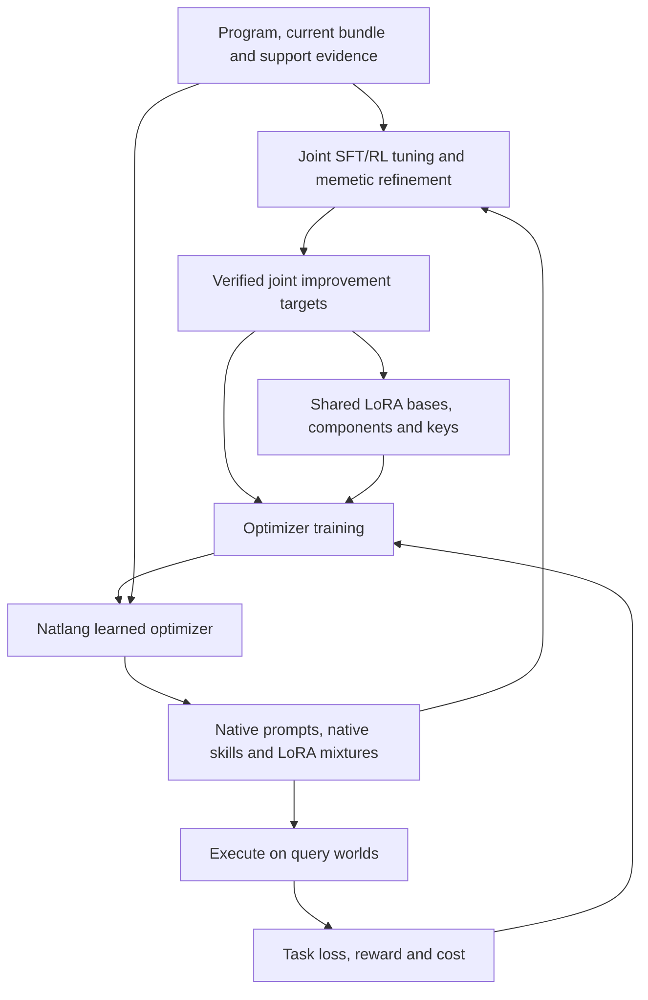

# A joint learned optimizer for Neuralese prompts, skills and LoRA

Owner-directed implementation plan, 2026-10-27.

**Deliver one complete system that learns to improve a Natlang program by jointly writing its native soft prompts, native soft skills and compact weight adaptations.** Use the existing SFT and RL tuner to produce supervised examples of useful improvements, learn reusable LoRA bases and a component bank with learned Neuralese keys from those improvements, train a Natlang optimizer to reproduce the resulting adaptation bundles, and train that same optimizer through the reward of the programs it improves. Its `iterateOn` adaptation loop revises the complete prompt, skill and LoRA mixture collection on every iteration.

All three output types belong to the implementation and its training from the outset. Target generation, shared-basis learning, component mixing and dropout, supervised writer training, meta-RL, memetic search, evaluation and deployment are cooperating parts of one system. The primary LoRA interface is an ordinary token-generated `number[]`, positionally aligned with an array of soft component descriptions. The change in training emphasis from supervised imitation toward reward optimization is an optimization schedule within that system. It is not a sequence of partial feature releases.

This document specifies the complete intended implementation. Statements about existing code are grounded in repository revision [`085f8075632b9398933c17923e5867a53aed8185`](https://github.com/werg/natlang/commit/085f8075632b9398933c17923e5867a53aed8185). Proposed types, modules and interfaces below are explicitly design work; their presence in this plan does not claim they are already implemented or trained.

## Contents

- [Motivation and intended result](#motivation-and-intended-result)
- [Existing machinery and the integration to build](#existing-machinery-and-the-integration-to-build)
- [Actors, state and the unit of adaptation](#actors-state-and-the-unit-of-adaptation)
- [Natlang-native program decomposition](#natlang-native-program-decomposition)
- [Adaptation and learner training through iterateOn](#adaptation-and-learner-training-through-iterateon)
- [Learning reusable LoRA bases from SFT and RL tunes](#learning-reusable-lora-bases-from-sft-and-rl-tunes)
- [Turning existing training into optimizer training data](#turning-existing-training-into-optimizer-training-data)
- [The learned optimizer and its supervised objectives](#the-learned-optimizer-and-its-supervised-objectives)
- [Meta-RL for the complete adapted program](#meta-rl-for-the-complete-adapted-program)
- [One continuous training operation](#one-continuous-training-operation)
- [Runtime, storage and deployment](#runtime-storage-and-deployment)
- [Concrete implementation changes](#concrete-implementation-changes)
- [Training quality, diagnostics and evaluation](#training-quality-diagnostics-and-evaluation)
- [Complete delivery and operating outcome](#complete-delivery-and-operating-outcome)
- [References and design context](#references-and-design-context)

## Motivation and intended result

Natlang already has an expensive way to improve a program: collect teacher demonstrations, run the student, evaluate its outcomes, and optimize the program's instructions, skills and weight residuals. Each such run contains knowledge about how to adapt a model. At present, much of that knowledge remains in the final program-specific artifacts and optimizer history.

The proposal makes those runs teaching material for an optimizer that is itself a Natlang program. It learns recurring relationships between evidence and useful changes: which instruction needs clarification, which skill needs different internal representations, which weight directions help a family of tasks, and which combination makes the whole program work better. On a new program it can produce an adaptation directly, improve an existing adaptation, or provide a strong starting point for further gradient tuning and search.

The intended learned operation is:

> Program and contracts + current adaptation bundle + demonstrations and rewarded experience → a better joint adaptation bundle.

This is learning how to improve the program. The demonstrations and execution trajectories are evidence supplied to that operation. The optimized prompt states, skill states and adapter parameters are its supervised output targets. A successful execution alone does not specify a unique adaptation, and a full-model checkpoint does not have a unique equivalent soft prompt.

There are two kinds of teacher in this arrangement. A stronger execution model supplies demonstrations and verified corrections. The optimization process supplies examples of improved adaptation parameters. Keep their identities and roles separate in the data.

The ambition includes:

- Fast adaptation to new programs and new invocation worlds from limited evidence.
- Repeated revision when additional demonstrations, failures or rewards arrive.
- Learning useful combinations of explicit prompt state, reusable skill state and persistent weight changes.
- Learning reusable directions of weight improvement across many SFT and RL tunes.
- Improving beyond the target generator's individual solutions through task reward.
- A memetic optimizer that combines learned proposals, reflection, selection, local gradient refinement and reuse of successful adaptations.
- Transfer across programs and skill families, with one shared implementation for the supported native model lines and separately identified parameters for each exact model.
- Applying the same machinery to the optimizer's own Natlang instructions, skills and adapters, with separately controlled outer evaluation.

Success is better task performance and/or less adaptation work for a given level of performance on programs and worlds that did not train the optimizer. Tensor reconstruction, successful serialization and nonzero gradients are useful diagnostics; they do not establish that result by themselves. No numerical improvement is assumed in advance.

## Existing machinery and the integration to build

The implementation should extend the current native paths. Historical projected-vector adapters and retired flat soft-block optimizer entrypoints are not the foundation of this work.

| Existing component | What it provides | Required integration |
| --- | --- | --- |
| [Joint tuner](../../training/neuralese/natlang_neuralese/tune/trainer.py) | Joint updates of hierarchical adapter parameters, family gates and native instruction/skill states; SFT and whole-graph RL; immutable artifact and optimizer histories | Export complete before/after improvement examples at real update boundaries, including exact evidence and subsequent evaluations |
| [Soft-state binding](../../training/neuralese/natlang_neuralese/tune/soft.py) | Text initialization in the actual rendered call context and replacement at instruction/skill consumption positions | Use the same binding and placement rules for generated states and target alignment |
| [Teacher-row conversion](../../training/neuralese/natlang_neuralese/tune/rows.py) | Teacher text rendered with the student's template, evidence weights and failed-history masking | Preserve the source of supervision and distinguish demonstrations from evidence-only attempts |
| [RL admission](../../training/neuralese/natlang_neuralese/tune/rl.py) and [round scheduler](../../ts-host/src/tune/rounds.ts) | Student rollouts with exact behavior artifacts and whole-program rewards; resumable SFT/RL fits | Connect outer optimizer actions to the program executions they cause, without weakening existing actor or replay checks |
| [Native state representation](../../training/neuralese/natlang_neuralese/model/state_block.py) and [shared execution](../../training/neuralese/natlang_neuralese/model/shared_state.py) | Actual per-layer KV/hybrid tensors, differentiable producer capture and consumer import | Add supervised captured-state targets and preserve gradients through learned writes and their consumers |
| [State derivation](../../training/neuralese/natlang_neuralese/model/native_state_derivation.py) | Verified direct tensor updates, parentage and optimizer continuation | Retain direct-optimization targets and distinguish them from actual writer captures |
| [Adapter parameterization](../../training/neuralese/natlang_neuralese/tune/parameterization.py) and [bases](../../training/neuralese/natlang_neuralese/tune/bases.py) | Free LoRA and fixed-subspace `U C V^T` coefficients, exact factor export and canonical basis identity | Learn shared bases and keyed components from useful effective updates; compose them from the optimizer's generated weight arrays |
| [Neuralese types](../../spec/ext/neuralese.md), [native values](../../ts-host/src/native/neuralese.ts) and [learning declarations](../../spec/neuralese.d.ts) | Typed soft values inside records, native producer returns, ordinary numerical results, and separate opaque adapter/tensor artifacts | Return soft prompt/skill values and aligned `number[]` weights; validate and compose executable adapters |
| [Iteration runtime](../../ts-host/src/runtime/iterate.ts) and [learning contract](../../spec/ext/learning.md) | Recorded sequential state transitions, stopping rules and explicit native learning operations | Implement the adaptation episode and outer learner-training controller through `iterateOn`, including data cursors, complete candidates and sequence learning |
| [Inference port](../../spec/NEURALESE_PORT.md) | Native-state templates, adapter stacks, and tool/syntax/repetition guidance | Add learned-key bank access, array/bank validation and whole-bundle construction; ordinary token output suffices for mixture weights |
| [Improvement records](../../ts-host/src/improvement/step-record.ts) | Before/proposal/after artifacts, evidence visibility, outcomes and compute accounting | Extend with joint bundle, evidence, training-target and behavior receipts; expose only causally available fields to the proposer |
| [Native memetic program loop](../../training/neuralese/natlang_neuralese/rl/memetic_program.py) and [batch driver](../../training/neuralese/natlang_neuralese/rl/memetic_batch.py) | Guidance proposals, native-state execution, source/world splits, search records and successful graph export | Generalize candidates to full bundles and collect optimizer trajectories, including rejected proposals |
| [Tuning runtime and releases](../../docs/TUNING.md) | Lexical adapter resolution, coherent releases, backend export, activation and rollback | Install and pin the entire generated bundle atomically, with actual native-state consumption receipts |

The current basis builder computes SVD bases from base weights. It does not learn them from a population of successful adaptations. The current memetic loop produces native guidance and execution graphs; it does not already supervise an evidence-conditioned optimizer against jointly optimized KV and LoRA targets. Existing `native_state_sft` is token supervision through native graphs, so state matching and generated-adapter supervision require explicit objective additions.

Some user-facing wiring and backend support remain incomplete in the current tuning documentation. In particular, the documented library SFT/RL round machinery must be traced through its actual CLI entrypoint, and native soft-state export is not uniformly available on all backends. Completing the new path includes its invocation, training and serving wiring; a library function or an artifact exporter alone is insufficient.

The conceptual direction continues [S6 meta-learning](S6_META_LEARNING.md) and [the learning continuum](LEARNING_CONTINUUM.md), using the present [Neuralese port contract](../../spec/NEURALESE_PORT.md) and [hierarchical tuning design](../HIERARCHICAL_LORA_TUNING.md). Their older projected-channel mechanisms are historical context only.

The intended connected system is:



## Actors, state and the unit of adaptation

### Separate the executor from its learned optimizer

Use the following names consistently:

- **Executor:** the student that runs the user's program under a particular adaptation bundle.
- **Target generator:** the expensive joint tuner and search/refinement process that improves a bundle using permitted training evidence.
- **Learned optimizer:** the Natlang program that reads evidence and proposes a new bundle. Its trainable model parameters are denoted by `theta`.
- **Shared adaptation representation:** per-model, per-target-matrix bases, reusable component cores and their learned Neuralese keys. These are learned across programs, and versioned separately from task-specific mixture coefficients. In the learning equations, `theta` includes whichever of these shared parameters are being updated together with the optimizer.
- **Evaluator:** the existing root oracle and execution machinery, operating on cases assigned to a declared data role.

An executor base is held fixed within a target-generation or learning campaign so its states and weight updates have a stable meaning. This does not forbid improving production base models. A changed base starts an explicitly rebound campaign that retains the old useful data and regenerates or explicitly translates targets where required. Shape equality is not model compatibility.

The optimizer's parameters are distinct from the program-specific parameters it predicts. Learning the optimizer updates `theta`; applying it creates a new bundle for a particular program. A tensor-valued output remains an output even when it later becomes an executor parameter.

### One complete adaptation bundle

An adaptation bundle contains:

- Native soft instruction states at the program's actual instruction bindings.
- Named native soft skill states, together with their skill contracts and consumption bindings.
- Adapter coefficient artifacts at the existing family/program/folder/lambda scopes, with the mixture encoding that produced them and any family gates and per-node scales needed to execute the stack.
- The exact base identity, target-matrix inventory, basis/component-bank/key versions and native-state layout.
- Parent bundle, source/evidence bindings, writer and derivation identities, and release dependencies.

The outputs are coupled. An instruction state optimized with one adapter may be ineffective with another. A skill can carry information that would otherwise need a weight update. The training data, proposal model, evaluation and release mechanism must preserve these relationships.

Different functions have different lexical stacks. A bundle is therefore a mapping over bindings and scope nodes, not a single global prefix and a single global LoRA. Preserve the existing rule that a callee executes its own definition's stack. Updates to a shared ancestor or shared skill must be evaluated on the affected descendants.

Use absolute resulting artifacts as the authoritative record. A proposal may also carry deltas from its parent for efficient learning, application and inspection. Delta validity requires identical base, tensor layout, target inventory and coefficient basis. A new skill, changed span length or changed basis is a structured replacement with explicit alignment and provenance.

The following is a proposed logical schema, not an existing SDK declaration:

```ts
type LoRAMixtureEncoding = {
  bank: ComponentBankRef;
  componentIds: ComponentId[]; // Explicit ordered coefficient axis.
  eligible: boolean[];       // Stable scope/model compatibility for this view.
  dropoutMask: boolean[];    // Recorded training mask; true means retained.
  weights: number[];          // Token-generated values; same length and order.
};

type LoRABankView = {
  bank: ComponentBankRef;
  componentIds: ComponentId[];
  descriptions: Neuralese<ComponentDescription>[];
  eligible: boolean[];
  dropoutMask: boolean[];
  available: boolean[]; // Derived by the host: eligible AND dropoutMask.
};

type LearnedRevision = {
  instructions: Record<BindingId, Neuralese<string>>;
  skills: Record<SkillBindingId, Neuralese<string>>;
  loraWeights: Record<ScopeNodeId, number[]>;
};

type AdaptationBundle = {
  schema: 'natlang.joint-adaptation/1';
  id: string;
  program: ProgramBindingRef;
  base: NativeIdentity;
  representation: RepresentationRef;
  parent: string | null;
  instructions: Record<BindingId, Neuralese<string>>;
  skills: Record<SkillBindingId, Neuralese<string>>;
  adapters: Record<ScopeNodeId, NativeAdapter>;
  loraMixtures: Record<ScopeNodeId, LoRAMixtureEncoding>;
  familyGates: Record<FamilyBindingId, number>;
  provenance: BundleProvenance;
};

type OptimizerInput = {
  program: ProgramContractView;
  current: AdaptationBundle;
  evidence: PermittedEvidenceView;
  history: PriorImprovementView[];
  representation: RepresentationRef;
  loraBanks: Record<ScopeNodeId, LoRABankView>;
};

type JointProposal = {
  parent: string;
  next: AdaptationBundle;
  edits: ArtifactEdit[];
  behavior: OptimizerBehaviorReceipt;
};
```

`LearnedRevision` is the model-facing return. A host composition service attaches the input bank identities and ordered component IDs, validates the weight arrays, and constructs the complete `AdaptationBundle` and `JointProposal`. The learner returns numbers for LoRA weights, not bank metadata or invented adapter IDs. The large component tensors travel through native storage and execution interfaces; only their compact mixture coefficients need to be generated as number tokens.

### Neuralese types and executable adapter values

The schema above describes the Natlang function boundary. Instruction and skill fields are actual `Neuralese<T>` values. The sketch uses `Neuralese<string>` for their written bodies; a callable soft skill keeps its binding's actual `Neuralese<F>` function signature. Preserve those semantic types and dialects in returned values and archived references. A record containing several soft fields already fits the [Neuralese type rules](../../spec/ext/neuralese.md); it does not require one opaque soft value around the entire bundle.

Outside the model, a soft value is the existing `$neuralese` reference to an `nzs1_` native state. `NativeAdapter` is the separate `$nativeAdapter` reference to an `nnt1_` coefficient artifact, and `NativeTensor` carries a named tensor reference and its kind. A type annotation does not convert one artifact kind into another. `Neuralese<LoRAMixture>` could describe a soft encoding of an adaptation, but it is not itself executable weight data. This design uses the simpler explicit boundary: soft component descriptions in, ordinary numerical weights out, exact bank composition into an adapter. It requires no new continuous output head for those weights.

For each scope, `loraMixtures` records the shared bank, coefficient order, stable eligibility, sampled dropout mask and generated weights. The effective availability is their elementwise conjunction. `adapters` holds the resulting complete composed cores that the existing executor can apply. The two forms must agree by exact composition; they are not independently editable authorities. Preserve zero mixtures and unchanged arrays as valid choices, and include a complete resulting adapter even when only a few weights changed. Keep any unrepresented part of a raw tuner target as a measured source residual rather than secretly installing weights absent from the learner's output.

The JavaScript object is therefore a typed manifest of values and references, with ordinary numbers for the mixture weights. Native tensors remain numerical data in artifact storage and live execution bindings. A valid artifact ID is returned by the service that captures or constructs the actual value. Position-to-component binding belongs to that service; array length alone is not enough to establish compatibility with another bank version.

### What a native state actually stores

For attention layers the learned objects are actual K and V tensors. A writer captures the tensors produced by its forward computation for a marked span. Direct state tuning changes the stored layer tensors themselves.

| Stored field | Meaning |
| --- | --- |
| `token_ids`, `positions` | Token IDs and original contiguous logical positions, stored as int64 tensors |
| `embeddings` | Ordinary input embeddings before the producer's low-rank embedding transform |
| Attention `raw_k`, `v` | Per-token keys and values for every attention layer, shaped `[tokens, kv_heads, head_dim]`; keys are after key normalization and before rotary position encoding |
| Finite-convolution `gated_inputs` | Per-token gated projected inputs before convolution |
| Gated DeltaNet `mixed_qkv`, `z`, `b`, `a` | Token-local projected quantities used to replay the span through the consumer's convolution and recurrent computation |
| Metadata | Text, architecture, checkpoint/tokenizer/embedding identities, layer kinds, adapter binding and derivation references |

The artifact contains the marked span, while the producer's preceding context can influence its values. It does not contain the entire preceding cache. A consumer rotates raw keys at its own positions. Hybrid consumers advance their own state using the stored token-local inputs; a producer's final recurrent-state snapshot is not substituted for that process. The artifact is stored as the existing native safetensors representation.

Direct state optimization retains the original text and token information while changing layer tensors. The original text is provenance and a source for re-initialization; it is not a claim that writing that text will reproduce the optimized tensor values.

### Writer identity and consumer compatibility

Training a writer to approach optimized native tensors is a central part of this plan. The existing differentiable capture path is the default mechanism. A new general state decoder is not a prerequisite.

Use an optimizer-specific writer adapter stack on the executor's exact native base/interface where possible. This lets the writer learn while preserving a well-defined target geometry. Record the actual writer stack and consume through the explicit supported same-base adapter-state mode when writer and executor stacks differ. Never relabel a writer's state as if it came from another actor.

If a training choice changes the writer's checkpoint, tokenizer, embedding interface or architecture beyond that contract, it must provide explicit compatible conversion or target-space output semantics. A foreign writer's raw KV is not admitted merely because it minimizes a numerical target loss. Keep such changes in the representation and runtime contract.

When the executor's task-specific LoRA changes, verify the state/bundle combination under its actual declared consumption mode. Preserve a direct-tuned target as a derived state; preserve a learned output as an actual writer capture. Neither should be given fabricated optimizer lineage or an invented recapture receipt.

## Natlang-native program decomposition

The optimizer is authored as typed natural-language functions with callable folders and services. Natural-language functions make semantic decisions. Exact tensor math, data custody, execution, storage and verification remain crisp mechanisms. The following decomposition is part of the single implementation specification.

| Responsibility | Form | Reason and implementation direction |
| --- | --- | --- |
| Interpret failures and demonstrations | NL function `interpretEvidence` | Decide what behavior is missing, which evidence matters and which explanations are plausible |
| Choose bindings, skills and scope of an update | NL function `chooseRevision` | A semantic policy over the program's contracts, dependency structure and observed failures |
| Write revised instruction and skill state | NL functions/native writer | Produce evidence-conditioned native spans; train their actual captured tensors and downstream use |
| Choose reusable weight components and their mixture | NL optimizer computation consuming learned Neuralese keys | Generates a typed, positionally aligned numerical array using its existing token head; exact bank lookup, validation and composition are crisp |
| Choose learned proposal, reflection, retrieval or local refinement | NL policy behind the existing pluggable pattern | Allows the memetic search strategy itself to learn; a recorded crisp baseline can use the same interface |
| Choose reuse, skill binding and stopping | NL policy with structural termination | Learns when more adaptation is valuable; exact resource use and declared limits are measured by the host |
| Build legal evidence views and splits | Crisp verifier | Causal visibility and source/world separation are exact data rules |
| Run the program and compute task outcomes | Existing execution service and oracle | Outside-world effects and declared correctness checks require exact implementation |
| Apply tensor deltas, basis transforms and optimizer updates | Shared crisp math | Arithmetic, shape checks, scaling and immutable derivation are exact mechanisms |
| Keep optimizer graphs and gradients connected | Shared native training/runtime mechanism | Actor-aware tensor dependencies must be preserved numerically |
| Persist a candidate, compare it and install a release | Existing store/release mechanism | Atomicity, parent comparison and dependency identity are exact requirements |
| Select training work and adapt the loss mixture | NL policy with recorded metrics and a pluggable deterministic baseline | A learning/operations decision; the actual scheduler, quotas and receipts remain crisp |

Place the application with the tuner/improvement code and reuse the existing policy interfaces. Proposed public names must be checked against the runtime's existing surface before being adopted. Authoring and integration guidance must describe any new model-facing interface and its recovery errors in the same implementation change.

The program's algorithm is:

1. Read the current program contract, coherent bundle and permitted evidence snapshot.
2. Interpret demonstrations, attempted actions, feedback and prior improvements in that snapshot.
3. Select compatible bindings and retrieve useful adaptation examples or skills when appropriate.
4. Produce a coordinated revision of instruction states, skill states and adapter coefficients.
5. Resolve the complete resulting bundle, validate its contracts and store its proposal receipt.
6. Run the program with that bundle and compute the declared outcome and cost.
7. Update the search population or current bundle using the configured selection policy, and record the complete improvement step.
8. Continue through the existing structurally terminating iteration mechanism when further work is useful.

The executor sees ordinary program inputs and the installed adaptation. It does not need to understand basis IDs or training receipt internals. Those belong to the implementation and inspection interfaces.

## Adaptation and learner training through iterateOn

### The adaptation episode

Implement repeated learner application as a Natlang `iterateOn` whose step revises a complete adaptation. Its state contains the current coherent bundle, best evaluated bundle or search population, permitted evidence cursor, prior improvement records, and optional typed Neuralese optimizer memory. Fixed episode arguments identify the program, task contracts, data roles and shared representation snapshot. The step returns the entire next episode state, including every prompt/skill binding and every scope's LoRA mixture and composed adapter. Unchanged entries are retained by reference.

One step performs the following operations:

1. Obtain the next permitted support batch or select useful previously seen evidence; record the exact data and exposure cursor.
2. Read the current bundle, prior measured attempts, recurrent memory and the ordered array of compatible soft component descriptions.
3. Propose coordinated prompt states, skill states and aligned LoRA weight arrays, including reuse or no-op choices.
4. Compose and validate the entire candidate, then execute it under one coherent binding on the declared adaptation-evaluation cases.
5. Record outcome and cost, apply the configured selection policy, update memory/history and return the complete next episode state.

An iteration need not be a whole pass over the dataset. It can process a batch, revisit informative failures, or request local joint refinement. Train on multiple iterations and repeated passes where the workload calls for them, including learning how earlier evidence should change a later update. Each proposal revises the whole collection jointly; prompts, skills and LoRA are present throughout the loop.

Useful improvement is the learned objective. Individual sampled proposals can fail. Retain their evidence and the best bundle under the declared selection measurements so the learner can explore and recover without discarding useful adaptations. A selected candidate may remain unchanged. Stopping is a Natlang policy over measured benefit and cost or a structural completion predicate, implemented through the existing `until`/`streamUntil` contract and its measure/limit requirements. Do not invent a mandatory fixed number of adaptation steps.

Distinguish feedback used to choose the next adaptation from outer-training query results. Support-side evaluation may enter the next step's evidence when that matches deployment. An outer query withheld for learning stays outside the learner-visible episode; its reward trains the shared learner afterwards. If online feedback is deliberately revealed, declare it as evidence for subsequent steps and use fresh withheld queries for their outer outcome. Protected reporting cases never become adaptation feedback.

### The outer learner-training operation

Use an ordinary Natlang training controller, also expressible with `iterateOn`, to consume episodes and update the shared learner. Its state includes optimizer parameters, trainable bases/component bank/keys, their numerical optimizer state, data/exposure cursors, RNG, behavior snapshots and checkpoints. Each logical update collects or replays complete episodes, forms supervised and whole-graph reward objectives, accumulates gradients against one shared parameter snapshot, applies the update and records actual exposure.

`iterateOn` supplies sequential orchestration and trajectory recording. It does not itself load training batches, compute gradients or implement meta-learning. Typed host/native services perform those exact operations; the Natlang controller decides which evidence, proposals, refinement and learning work to request. Reuse [the iteration runtime](../../ts-host/src/runtime/iterate.ts) and [explicit learning operations](../../spec/ext/learning.md), and connect both controllers to real entrypoints.

Train supervised predictions at useful points throughout an adaptation history, and train reward on the sequence's resulting quality and total work. Include histories generated by the current learner, rejected candidates, recovery, stopping and no-ops, as well as tuner histories. Preserve continuous dependencies through generated memory and native states across iterations, and the policy likelihoods of discrete choices including numerical output tokens. A parsed weight array does not acquire a differentiable path back into its tokens. Record the actual support/executor trajectories needed to assign sequence credit; any truncated backpropagation or replay approximation must be declared and measured.

At application time the shared learner, bases, component bank and keys can remain fixed for the episode. Forward execution still produces new prompt/skill tensors and task-specific LoRA weights at every iteration. Gradient-based local tuning is an available operation inside the same loop, rather than a requirement for every learned update. Updating the shared learner itself is the separate outer operation, with the existing self-improvement case handled as an explicitly evaluated outer episode.

## Learning reusable LoRA bases from SFT and RL tunes

### Representation and meaning

For target matrix `m` and adaptation `j`, use

$$
\Delta W_{j,m} \approx U_m C_{j,m} V_m^\top.
$$

`U_m` has shape `[output_width, rank]`, `V_m` has shape `[input_width, rank]`, and `C_{j,m}` is a full `[rank, rank]` matrix. Keep model expert axes explicit for expert banks. At rank 8 the core has 64 coefficients per target matrix; it mixes all pairs of left/right basis directions. The primary learner predicts a compact array of mixture weights for shared component cores, whose exact composition produces `C`. It need not emit every entry of every core.

The shared bases should be primed for useful adaptations. Learn them across task/program-specific SFT and RL tunes on the same exact base. A single pooled fine-tune does not reveal the variation among useful adaptations.

Use the effective weight changes, including LoRA scaling, as observations. For free LoRA this is `(alpha / rank) B A`. Independent `A,B` pairs have scaling and rotation ambiguities, so their raw coordinates are unsuitable targets for a shared basis. Preserve the original effective update even after it is compressed.

Fit both successful final residuals and useful incremental changes, labeling which quantity each row represents. Final residuals teach initialization; incremental changes teach revision. If only the current restricted bases generated the archive, their outputs cannot expose directions outside that subspace. Include free-LoRA tunes or corresponding gradient/update information to discover additional useful directions.

### A component bank with learned soft descriptions

Use an ordered bank of reusable weight changes. For scope `s` and target matrix `m`, define

$$
C_{s,m}=\sum_{k=1}^{K} d_{s,k}\,a_{s,k}\,C_{k,m},
\qquad
\Delta W_{s,m}=U_m C_{s,m}V_m^\top.
$$

`C_{k,m}` is component `k`'s core for matrix `m`. A component can contain coordinated changes across many matrices. `a_s` is the returned `number[]`, with exactly one number per supplied description. `d_s` is effective availability, the conjunction of stable scope/model eligibility and the sampled dropout mask. Preserve both source masks separately; unavailable positions must have zero returned weight. The host composes the full adapter using these same positions. In this interface a "LoRA base description" means a description of one complete reusable component, not a description of `U` or `V` alone.

The mixture weights are finite signed numbers, not necessarily probabilities or values summing to one. Family gates and scope scales remain separate, with their existing composition semantics. Compose the core, then apply those scales exactly once. If a recipe chooses coefficient bounds or normalization, record that choice and its effect on expressivity. Do not impose an unexplained softmax or clamp. Model expert dimensions, scope eligibility and target-matrix masks remain explicit.

Associate each component with a short `Neuralese<ComponentDescription>` value occupying a few native token positions. It has the actual KV/hybrid-state representation, native identity, positional handling and derivation requirements of other Neuralese values. Supply the ordered array of descriptions, availability and current weights to the optimizer. Keep the exact component IDs and bank version bound by the host, so the model only has to return the aligned weights.

The soft descriptions are learned keys for useful adaptations. Initialize them from descriptions where useful, then directly train their native-state tensors as shared parameters using the existing state-gradient machinery. Updating those tensors need not change their original token text; the text remains provenance. Their use in the optimizer's token probabilities and native writes provides training signals. Keep the key-to-component association explicit and versioned. The term "key" here describes a component descriptor; it is distinct from the per-layer attention `raw_k` field.

A few native positions help the learner recognize a component; they do not serialize its full weight change. The numerical bank contains the actual values. One description can identify a component spanning many matrices, and the shared descriptions need not be regenerated on each application. Report their actual tensor storage and context cost. This uses native Neuralese communication and exact coefficient artifacts, not the retired projected-vector adapter-code transport.

Learn the bases, components, keys and optimizer jointly from tuning targets and downstream task behavior. Normalize component scale so arbitrarily enlarging a component and shrinking its coefficient cannot distort sparsity penalties or numeric precision. Keep target decomposition identifiable through a pinned fitting rule, while recognizing that several mixtures may implement the same effective update. Decoded weight/behavioral losses and actual task results take precedence over an arbitrary decomposition.

The simple weight array represents the span of its component bank. It cannot express an independent full per-matrix residual unless that residual is represented by additional bank components. Retain source residuals and measure the loss of useful behavior when fitting target mixtures. Learn or expand the bank from those residuals and compare against direct joint tuning. A richer explicit mode could add `R_{s,m}` to the composed core and supply it through a separate tensor output path; that is an alternative representation, not a hidden output or a requirement for the agreed `number[]` interface. Local tuning can also produce a richer source target, whose mixture approximation must be evaluated before it becomes a learner-output target.

### Mixing and base dropout

Implement mixing during target fitting, supervised training, reward training and serving. Examples must include useful multi-component combinations and different numerical strengths, rather than only one-hot adapter selection. Evaluate the complete prompt/skill/mixture candidate: two separately successful components are not assumed to combine successfully. Fit projected coefficients and re-evaluate/refine their joint behavior, retaining no-op, cancellation, failure and recovery cases.

Implement base dropout as an explicit training-time component mask. Randomly disable selected components, expose the mask to the learner, and train it to find useful combinations among the remaining entries. Keep array positions and length stable within the episode; a disabled entry is marked unavailable and its returned weight must be zero. Do not silently delete descriptions, renumber components or bind surviving weights to different entries. An explicitly compacted bank view is legal only with its own pinned ordered mapping, supplied and recorded as a different view.

Sample masks independently of the current proposal, record their RNG and probabilities, and keep the mask fixed for a replayed episode. No standard inverted-dropout rescaling is applied implicitly: the coefficients describe the actual adapter executed. Refit or select supervised mixture targets under the same mask and evaluate their quality; zeroing a dense target's coefficients does not establish a useful dropout target. An all-disabled mask has an explicit treatment, either a valid zero-adapter/prompt-and-skill episode or a declared exclusion from the sampling law.

Default learner application uses every eligible component, with the dropout mask set to all retained. Turning dropout off never overrides eligibility. Include full-bank episodes during training and report component exposure, utilization, pair/co-occurrence coverage, coefficient magnitudes, dropout robustness and full-bank task performance. Repeated unused or interchangeable components call for better data, descriptors or bank fitting, not fabricated component credit. Permuting descriptions and their matching tensors/weights together during training can test dependence on description content; never permute just one side of the alignment.

### Basis fitting and behavioral refinement

An initialization objective is

$$
\mathcal L_{\text{basis}} =
\sum_{j,m} w_{j,m}
\frac{\|\Delta W^*_{j,m}-U_m C_{j,m}V_m^\top\|_F^2}
     {\|\Delta W^*_{j,m}\|_F^2+\epsilon}
+\lambda_{\text{condition}}\,\mathcal R(U,V).
$$

Weights balance programs, scope levels and task families, with measured improvement and evidence reliability recorded explicitly. Do not allow one large-magnitude update, one prolific program or many checkpoints from one run to define the basis by accident. Zero and near-zero updates need an explicit normalization floor and their own accounting.

Maintain orthonormal columns or an equivalently well-conditioned parameterization. For orthonormal `U,V`, the least-squares core for a fixed basis is

$$
C^* = U^\top \Delta W^* V.
$$

This projection is a coordinate computation, not proof that the compressed adapter preserves the teacher's behavior. Record its residual and execute the complete compressed bundle. Jointly refine its states and coefficients when compression changes the useful solution.

Fit the reusable component cores and target mixture arrays in these coordinates, using the same weighted effective-update loss with `C_{j,m}` replaced by the masked component sum. Use declared regularization and component normalization to resolve scale/selection ambiguity. Preserve both the basis projection residual and the additional component-bank residual. Learn the soft descriptions and weight-token policy against these targets and their actual task utility.

Refine the shared bases and component cores with downstream supervised loss and the valid reward-gradient path described below. Weight reconstruction supplies an initialization and an auxiliary signal; task outcomes determine whether the directions and their combinations are useful. The descriptions and mixture policy should learn to allocate that capacity to the actual task distribution.

Keep rank, target inventory and scope-level capacity configurable in the same implementation. Use the existing sweep/placement machinery and actual memory, latency and quality measurements to select them. Rank is not a claim that all useful adaptations lie in the pretrained weight's leading singular directions.

Compute effective-update losses and covariance statistics from low-rank factors where possible. Avoid materializing a full dense model-sized delta merely to compare low-rank updates. Stream per-matrix/expert statistics and preserve exact algebra and scaling.

### Stable coordinates, refresh and export

Each learned basis is immutable and identified by base, target name/orientation, rank, training method and actual tensor content. Extend the existing basis artifact and registry; do not pretend that a learned basis was produced by `weight-svd-sign-canonical-v2`.

All scopes that use nested rank slices must refer to the same maximum-rank basis version. Learning an unrelated basis independently for each node forfeits the existing common-basis composition rule. Rank-prefix usefulness must be trained or measured; a set of orthogonal learned columns is not automatically ordered by usefulness.

Basis refresh has two supported forms within the same training system:

- Hold a basis version fixed for a set of target examples and updates. Predict its coefficient targets directly.
- Learn the basis while supervising decoded effective weight changes and downstream behavior. Recompute coordinate targets from retained effective updates whenever the basis changes.

An old `C` label never silently acquires new bases. If orthogonalization changes coordinates without changing the subspace, transform the cores accordingly. For example, with `U = Q_u R_u` and `V = Q_v R_v`, the equivalent core is `R_u C R_v^T`. A genuine subspace change generally leaves projection error and needs a new measured bundle.

Version the component tensors, their native descriptions, ordered IDs, eligibility and number-format contract as one representation dependency. A key or component update creates a new snapshot; an old weight array never silently refers to a reordered or changed bank. Apply coordinate transforms to every affected component core and target. Refit mixture labels when component meanings change, or supervise decoded effective updates rather than stale labels. Pin the shared snapshot throughout each collected adaptation episode; training can differentiate that snapshot and publish the next version only at the update boundary.

Export through the existing exact factors: `B = U C`, `A = V^T`, with declared scaling folded exactly once. Compose the bank's weighted cores before this export; common-basis stacks can sum appropriately padded cores, while unrelated bases use the existing exact factor concatenation. Record shared basis, component and key storage separately from per-program weight-array storage. A compact program code does not make the shared representation free.

## Turning existing training into optimizer training data

### Data roles and splitting

Split source/world connected components before collection, trajectory expansion, target tuning or basis fitting. Keep aliases, near duplicates, repair variants and cases sharing a world on the same side. Include program/template family grouping when testing transfer across programs.

Use distinct roles:

| Role | Permitted use |
| --- | --- |
| Adaptation support | Visible to the proposer; used by the target generator and local refinement. Contains demonstrations, inputs, allowed task contracts and prior attempts/rewards |
| Outer-training queries | Hidden from the proposer for that proposal; their outcomes and losses train the optimizer after execution |
| Development programs/worlds | Select recipes, loss weights, search policies and capacity; repeated use is acknowledged as selection |
| Confirmation/protected tests | Final reporting for a fixed selection; no target generation, basis fitting, reward updates or selection feedback |

Queries used for outer gradients are training data even though the proposer cannot see them. Do not describe them as untouched evaluation. Reserve complete unseen programs and meaningful unseen families for generalization claims, as well as fresh worlds within familiar programs.

The evidence view must enforce deployment-time visibility. Historical support rewards may be visible. The current proposal's future query outcomes, target artifacts and final-test information are not input features. Existing `stepView` removes `outcome` but still contains other record fields; define a narrower typed proposer input so `after`, supervised targets and future proposal metadata cannot leak through a convenient record serializer.

### What to retain from SFT

Retain the program contract, exact teacher request/reply, tool calls and observations, root/binding identity, verification evidence, teacher identity and source partition. Render demonstrations for the student's own tokenizer and template, as the current converter does.

Retain the complete trajectory, including context and failures, with explicit target masks. Verified teacher actions and admitted repairs provide positive action targets. Failed actions remain diagnostic context. A successful parent does not automatically make every child action a correct target.

Keep primary action/reply supervision separate from auxiliary prompt/input/tool-text supervision. Long repeated prompts must not dominate the evidence or learning objective merely because they contain more tokens. Preserve the current ability to set auxiliary prompt weight to zero where that is warranted.

Teacher KV from another model is not a target in the executor's native state space. The teacher demonstrates behavior; the target generator produces student-compatible native states and weight adaptations that learn that behavior.

### What to retain from RL

Retain the student's whole executed native graph, sampled tokens, forced-token masks, root reward and its oracle, actual actor at every invocation, effective adapter stacks, soft-state versions, sampling settings and old log probabilities. Preserve dependencies from actual producers to their consumers.

Failed and zero-reward attempts remain useful optimizer input and can support preference or diagnostic learning. They are not positive demonstrations of the actions to imitate. Infrastructure errors are unscored with an explicit reason. Program failures and applicable execution-limit failures receive the declared task treatment; do not silently drop hard cases from the denominator.

An exact historical assistant message is an SFT label, not a valid task reward when alternative continuations can be correct. Reuse authenticated root oracles and declared semantic checks. Include correct blocked/declined outcomes only when the task contract says they are correct.

The current inner GRPO path needs reward contrast within groups. Equal-reward groups do not supply a group-relative policy update. Record this honestly and use their traces through the appropriate other objectives. Training-work selection should seek informative tasks/attempts without inventing reward variance.

### Joint target generation

For each training episode, initialize or load a coherent bundle and run the existing joint tuner on its support evidence. Enable instruction states, relevant skill states and weight adaptations together. The optimization can combine verified SFT, on-policy correction, RL and memetic refinement according to the declared recipe.

Capture before/after records at actual logical update boundaries and useful search/refinement transitions. Retain intermediate improvements as well as final outcomes. The learned optimizer needs examples of both creating an adaptation and revising one that is already useful.

Each target record binds:

- Program, call bindings and the complete before/after bundles.
- Exact support rows and attempts available before the proposed change, with their visibility and order.
- Objective, recipe, optimizer settings, optional gradient summaries, and compute used to obtain the target.
- Source/target actor identities, tokenizer, native layout, basis/component-bank/key versions and target-matrix inventory.
- Ordered component IDs, availability/dropout mask, fitted weight arrays, fitting rule, numeric serialization and any unrepresented source residual.
- Complete source trajectories, producer tokens, state slot alignment and consumption positions.
- Paired outcome measurements on their declared roles, including uncertainty/replicates where available.
- Parent artifact and optimizer-state lineage, RNG state/exposure cursor needed to resume the target run.

The target generator may spend more compute than the learned optimizer; that is the point of learning from it. It may not use extra task evidence hidden from the recorded optimizer input and then claim the result is a deterministic update from that input. Either include that support evidence in the input or label the task as a different conditional prediction problem.

If exact optimizer-step imitation depends on Adam moments or other internal state, expose the relevant state or a defined digest. A task-level improver can instead learn useful before/after changes without promising to reconstruct the exact numerical next step of an unseen optimizer.

A target is a complete tuple. Do not pair the best prompt from one run with the best skill and LoRA from other runs without evaluating that combined candidate. Do not average incompatible successful states into one supervised label. Keep multiple verified target tuples as alternatives with their own evidence and quality; train a conditional distribution or sample complete targets.

Preserve unsuccessful proposals with a defined training use: diagnostics, value prediction, preferences, recovery or stopping. Weight accepted improvements by measured utility and confidence, while retaining coverage of small improvements and no-op cases. Filtering only spectacular winners creates an unrealistic training distribution.

### Data integration and custody

Extend `natlang.improvement-step/1` with references to a versioned joint-target record instead of embedding huge tensors. Reuse canonical hashing, native artifact storage, source admission, split manifests and exposure accounting. The tuple, its evidence and its target artifacts must be resolvable as one dependency closure.

Retain these as useful training sources under the existing data registry and manifest conventions. Keep acquisition, validation, admission and actual optimizer exposure separate. A graph export is not a training update. A readback or a queued job is not completed exposure.

Keep collections of updates from one run identifiable. Sampling should balance programs/families and avoid treating thousands of correlated intermediate checkpoints as thousands of independent adaptation problems. Add current-optimizer proposals and their refinements to the data so training does not remain confined to the initial tuner's state distribution.

## The learned optimizer and its supervised objectives

### Evidence and output computation

The optimizer receives a structured program view, native current states, current numerical weight arrays, ordered soft component descriptions and availability, and a selected set of support trajectories with outcomes. It uses ordinary typed values and real native state through the existing ports. Evidence selection and summarization are learned Natlang policies; exact source links remain available so a digest does not erase the observations it summarizes.

Represent bindings, scope level, skill role, layer kind, matrix name and current artifact identity explicitly. The model needs to distinguish a shared program-level update from a leaf-specific repair. Evidence and outputs must not depend on accidental directory iteration order or an undocumented tensor flattening convention.

Use one shared optimizer computation with coordinated output routes:

- The native writer produces the new instruction and skill spans.
- The existing token head produces a typed `number[]` for each scope, aligned with that scope's supplied component descriptions.
- Structured decisions describe skill reuse, binding changes, span replacement, parent/operator choice and stopping.

Generating the short array uses the model's existing ability to emit number tokens. Training must teach which combinations improve programs; producing valid numerical syntax is only the output mechanism. A crisp service checks the result, combines the component tensors and materializes an existing native adapter artifact. No new numerical head, learned tensor decoder or generated artifact ID is required for this path.

The authoritative return contains absolute resulting weight arrays and complete prompt/skill values. A declared delta-array mode may be used internally for small revisions, but must specify the parent, bank version and exact conversion to absolute weights. Exact native state assembly and coefficient composition remain host mechanisms. New or resized state spans use a writer-generated replacement with a declared alignment rather than arithmetic over unrelated token slots.

### Typed value and tensor boundaries

The primary model-facing boundary is already expressible with Neuralese fields, arrays and numbers. Extend its binding, validation and training integration without redefining these types. Native state parts let the optimizer consume current prompts, skills and learned component descriptions as native context. Ordinary typed arguments carry the current weight arrays and availability masks. Neither representation makes individual KV entries inspectable by JavaScript.

Validate each returned array against the bank view bound to that invocation: exact length, positional component mapping, scope, version, availability, finite values and any explicitly declared numerical bounds. Require zero weights for unavailable entries and preserve no-op behavior. Resolve state outputs against their semantic type, dialect, binding and layout. The host constructs the complete manifest and corresponding adapter artifacts only from validated values. Existing tool/syntax guidance helps generation; a declared `number[]` type alone does not enforce all these cross-value constraints.

Use a versioned number serialization for supervised targets, with precision selected from measured effect on the composed adapter. Canonicalize equivalent forms such as negative zero; support only declared finite numeric syntax. Preserve the actual generated tokens and parsed values in policy receipts, even when several spellings yield the same number. Do not round, clamp, normalize or remap sampled output silently. Contract failures and repairs are recorded parts of the learner trajectory, including their cost and sampling likelihood.

For training, historical evidence and detached targets are constants. Current writer outputs, generated recurrent memory and trainable shared keys/components/bases retain their graph ownership through all consumers. Parsed numerical tokens are fixed actions during differentiation; their learning signal comes from token supervision and policy likelihoods. Serialization creates durable detached copies without replacing live values that still have a valid continuous training path. Across service boundaries, an execution-scoped tensor binding or exact cotangent replay reconnects those values to their producer. Expired graph handles fail explicitly.

If an explicitly selected representation also consumes arbitrary core/gradient tensors or emits full residual cores, give it named native-tensor slots and a trained numerical encoder/readout. Such slots bind artifact kind, scope, matrix/field, shape, dtype, masks, representation and actor identity, plus live gradient ownership. They are an optional richer interface; they are not needed to output the compact weight array and must not be represented as already supported by ordinary `native_state` content parts. Local internal numerical features do not replace the native Neuralese communication format.

Exercise the required path through actual typed returns, native capture/import, aligned weight arrays, exact adapter composition and their training traces. Mark any new port capabilities only when request, training and serving behavior exists. The delivered joint optimizer must not depend on an optional tensor-output capability merely to produce a mixture of an existing bank.

### Supervised matching of native states

Let `T*` be a detached optimized target tensor and `T_hat` the corresponding tensor captured from the trainable writer. A normalized state objective is

$$
\mathcal L_{\text{state}}
=\operatorname{mean}_{\text{blocks}}
 \operatorname{mean}_{\text{layer,field}}
 \operatorname{mean}_{\text{valid entries}}
 \rho\!\left(\frac{\widehat T-T^*}{\sigma_{\text{layer,field}}+\epsilon}\right).
$$

Use squared error or a declared robust loss, with scale statistics computed from training data only. Normalize across blocks, layers and field sizes so a long skill, high-width layer or hybrid field does not overwhelm all other targets. Keep K, V and every supported hybrid field separate in reporting. Match the native pre-rotary representation and preserve exact target geometry and valid-slot masks.

The initial alignment for a target is supplied by its retained producer tokens and state layout. Teacher-force/replay those tokens while matching the captured state. This teaches the evidence-conditioned writer's continuous computation to produce the target representation. Auxiliary token/structure supervision teaches the sequence and its complete typed return, including producer boundaries and sibling fields.

A tensor loss does not differentiate through sampled token IDs. Free token choices use token likelihood objectives and the policy-gradient terms below. If span lengths differ, use an explicitly trained alignment or behavior-only supervision for that candidate. Do not pad, truncate or compare unrelated positions and call that exact target matching.

The writer's keys and values arise from projections, normalization and preceding layers; direct tuning can vary stored entries independently. Exact reproduction of every arbitrary directly tuned tensor is not guaranteed. Train the existing writer against useful targets and inspect the actual causes of mismatch. Preserve raw targets, field-wise error and downstream performance so representation error can be distinguished from missing gradients, incorrect masks, actor mismatches or numerical bugs. An explicit learned residual readout can be introduced within the same writer interface if a demonstrated representational constraint warrants it; it is not assumed necessary in advance.

### Adapter and structural supervision

For a fixed basis/component-bank version and availability mask, fit useful target weight arrays and train their canonical numerical token sequences with cross-entropy. Include all positions, zero weights and the exact array structure, balancing so abundant masked zeros do not dominate useful coefficient choices. Preserve multiple useful complete mixtures when labels are ambiguous. Numeric output competence is trained alongside selection of the right components and magnitudes.

Compose the predicted or target array into a core and measure the decoded effective weight error:

$$
\mathcal L_{\text{weight}}
=\operatorname{mean}_{m}
\frac{\|U_m\widehat C_mV_m^\top-\Delta W_m^*\|_F^2}
     {\|\Delta W_m^*\|_F^2+\epsilon}.
$$

For fixed or teacher-forced numerical weights, this loss differentiates into trainable component cores and bases. It does not differentiate through a parsed sampled number into the token generator. Train that generator with token supervision and the policy-gradient objective below. A full-core numerical output variant, if explicitly selected, has its own continuous regression path; do not assume that path for ordinary `number[]` token generation.

When bases or components are being learned, the decoded loss remains meaningful while stale mixture labels do not. Include retained basis and bank projection residuals; a correctly predicted compressed mixture can still miss useful directions of the original free adapter.

Supervise actual structural decisions and complete return contracts: which binding is changed, which skill is reused or replaced, the producer spans, any sampled operator choices and whether to stop. Targets for discrete choices come from recorded accepted operations or measured alternatives, with their ambiguity preserved.

### Downstream supervised behavior

Install the generated bundle in the executor and compute supervised action/reply loss on appropriate outer-training examples. Backpropagate through generated native states and through composed adapters into any trainable shared component cores/bases. The executor's base weights can remain fixed while its computation still provides derivatives with respect to these inputs and adaptations. The numerical-token policy receives its separate supervised or reward learning signal; parsing its weights is not a differentiable connection.

Use the shared native graph execution path. The optimizer's writes and actual executor consumers must remain connected in the live gradient computation. Persisting an artifact for durability does not justify detaching its producing tensor when that producer is being trained.

Frozen target artifacts and historical support data are legitimate external inputs. Current trainable writer outputs are not. In a split-process implementation, transport exact named cotangents back to the correct live/replayed producer and verify equivalence to a single-process graph. Preserve per-invocation actors and functional generated weights. A Python list of independently trained turns cannot replace the whole producer-consumer dependency graph.

An overall supervised loss is

$$
\mathcal L_{\text{sup}}
=\lambda_P\mathcal L_{\text{instruction state}}
+\lambda_S\mathcal L_{\text{skill state}}
+\lambda_M\mathcal L_{\text{mixture tokens}}
+\lambda_C\mathcal L_{\text{core/weight}}
+\lambda_A\mathcal L_{\text{structure/tokens}}
+\lambda_B\mathcal L_{\text{downstream behavior}}.
$$

Balance by program/binding and report the raw terms, weights, gradient norms and actual parameter changes. Use disjoint token masks for mixture-token and other structural-token terms so the same digit is not silently counted twice. Record which trainable parameters each term can actually reach. The downstream behavior term prevents numerical resemblance from becoming the sole goal. Keep supervision from SFT-derived and RL-derived targets identifiable, while allowing both to teach the same optimizer.

## Meta-RL for the complete adapted program

### Reward and the optimization problem

For a permitted support context `x`, the optimizer proposes a joint bundle. The executor uses it on query inputs the optimizer has not seen for that proposal. The reward measures the whole program's declared task outcome.

A useful return is paired improvement over the incoming bundle, with explicit optional costs:

$$
R = \operatorname{quality}(A_{\text{new}},Q)
  - \operatorname{quality}(A_{\text{before}},Q)
  - \lambda_{\text{adapt}}\operatorname{adaptationCost}
  - \lambda_{\text{run}}\operatorname{executionCost}.
$$

Use the same worlds and suitable common random seeds for paired comparisons. Keep task quality and each cost separately visible. Cost weights express a declared user/workload tradeoff; they must not silently replace correctness. Storage, latency and model-call costs can be reported as a frontier as well as a scalar objective.

The pre-update baseline depends only on the incoming context and independent baseline execution, not on the proposal whose advantage it estimates. Detach it in score-function losses. For multi-step adaptation, use terminal and intermediate gains with a declared return definition; avoid counting the same improvement once at each step and again in the terminal total.

### Gradients for native states, numerical tokens and the shared bank

The native implementation trains continuous prompt/skill states and shared basis/component tensors through executor action log probabilities, without sampling every KV entry as a separate action. Mixture-number tokens receive policy-gradient credit. These are distinct paths in the joint objective, because parsing their numbers is not differentiable.

Let `z` contain the optimizer's sampled discrete decisions, producer tokens and the tokens spelling its numerical arrays. Parse those number tokens into fixed coefficient values for the differentiation step. Given `z`, the writer and bank composition produce `A_theta(x,z)`; the native states and any trainable bases/components can still depend continuously on `theta`. The input `x` includes the supplied component ordering and exogenous dropout mask. Let `tau` be the executor's complete sampled program trajectory. With external world transitions independent of `theta` once actual actions are fixed, the relevant joint likelihood is

$$
q_\theta(z,\tau\mid x)
=\pi_\theta(z\mid x)\,
p_{\text{exec}}(\tau\mid A_\theta(x,z)).
$$

For outcome reward with no additional direct parameter dependence,

$$
\nabla_\theta J
=\mathbb E\left[(R-b)
\left(\nabla_\theta\log\pi_\theta(z\mid x)
+\nabla_\theta\log p_{\text{exec}}(\tau\mid A_\theta(x,z))\right)\right].
$$

The first term trains sampled optimizer choices, including every generated sign, digit, decimal/exponent and array position. It also trains shared soft descriptions through their effect on those token probabilities. The second trains the continuous native-state writer and any trainable bases/components through executor action log probabilities, plus shared keys when a live continuous path through the writer exists. It does not backpropagate through number parsing. Freezing the executor's base weights does not remove the valid derivatives: its behavior still depends on `A_theta`.

Implement this through the existing whole-graph recorded-policy machinery, extended to the optimizer's producer invocations, numerical-token actions and composed adapters. Preserve every actual sampled model turn, stop decision, producer span, key use and consumer import. Forced template tokens or forced unavailable-slot zeros have zero sampling score; their continuous computations can still transmit gradients. Reward remains an oracle result; no derivative through the oracle itself is assumed. Do not use an undeclared straight-through gradient for parsed numbers.

For a multi-step `iterateOn` episode, factor the joint likelihood over optimizer and executor turns in their actual temporal order. Credit includes the effect of an earlier adaptation on later evidence and decisions, with generated recurrent memory and native states reconstructed through the episode. A sum of unrelated one-step losses over detached historical bundles does not implement this sequence objective. Use return-to-go or appropriate prefix baselines for stepwise credit without double-counting intermediate and final gains.

A global baseline conditioned on the pre-proposal context is valid for both score terms. More detailed critics may condition on the relevant sampled prefix before the action being scored. Do not use an action-dependent baseline for that same action without the corresponding correction. If a cost has a direct differentiable dependence on the bundle, include its direct derivative in addition to likelihood-ratio terms.

If a continuous action is explicitly sampled, record its density and use a correctly derived estimator. In the fixed-action score calculation, hold that sample fixed; do not accidentally add a reparameterization gradient for the same effect and count it twice.

### Reusing rollouts correctly

Keep the exact old proposal and executor likelihoods, the numerical token spellings and parsed arrays, the executed old bundle and all identities in the receipt. For an importance-ratio or PPO-style update on stored `z,tau`, the joint ratio is

$$
r_\theta=
\frac{\pi_\theta(z\mid x)}{\pi_{\text{old}}(z\mid x)}
\frac{p_{\text{exec}}(\tau\mid A_\theta(x,z))}
     {p_{\text{exec}}(\tau\mid A_{\text{old}}(x,z))}.
$$

Regenerate the current bundle for the same recorded optimizer actions, then replay the same executor actions and observations under it. The parsed numerical weights are the same actions, while the actual mixture can change if the trainable component bank or bases changed. The frozen executor weights do not cancel the second ratio. A ratio over optimizer tokens alone is insufficient when continuous writer/bank changes alter the bundle those tokens produce.

Use the exact same dropout mask, positional mapping and action spellings in old/current comparisons; record the respective bank/key snapshots. An exogenous mask is conditioning data and contributes no learner policy score. Preserve component identity and replay-compatible membership when parameters change; a changed mapping or numeric interpretation requires new labels/rollouts. For recurrent episodes, regenerate the whole dependent sequence rather than substituting old generated memory into the current policy.

Require replay-compatible inputs, tokenizer, action support, native layout and graph topology. Record all sampling distributions, temperatures, masks and forced choices. Environment/tool observations are replayed with their exact action/result custody. Changes that cannot score the same sampled actions require fresh rollouts. Clipping a ratio does not repair an omitted likelihood term or an incompatible replay.

The equation defines the joint objective. Any per-token, clipped or group-relative surrogate used for efficiency is an explicit estimator choice, with its normalization and approximation recorded. Reuse existing policy math rather than building an unexamined second RL implementation.

For a backend that cannot provide differentiable native execution, a supported alternative is a stochastic compact proposal code decoded by a pinned writer/basis snapshot. Train its sampling policy from black-box reward and retain supervised training for the writer. Recollect when that decoder changes. This route must not be mislabeled as reward training of every deterministic decoder parameter. The native whole-graph path is the intended complete mechanism.

### Multi-step memetic optimization and self-improvement

The optimizer may keep a population of coherent bundles, select parents, retrieve related adaptations, propose mutations, request local joint refinement and decide when to stop. Every operator application uses the same improvement record and evaluation contract.

Train on entire adaptation histories as well as single updates. Reward the useful result of a sequence and the cost of obtaining it. Include exploration, rejected proposals, recovery and no-op choices. Learned crossover or component reuse proposes a new complete candidate that is evaluated; independently successful components are not assumed composable.

Use the learned optimizer's proposals as initial conditions for the expensive tuner. Refinements provide new supervised targets near the optimizer's own state distribution. Query outcomes provide the outer reward. The target generator remains useful while the learned optimizer becomes stronger, and the learned optimizer can exceed a particular target through the reward objective.

The optimizer's own Natlang instructions, skills and adapter can also be improvement targets. Treat that as an outer adaptation episode with separate program pools, exact lineage and independent outcome measurement. It must not select its own success oracle or train on the protected cases used to judge that revision. Shared primitives handle this recursion; a separate incompatible self-improvement framework is unnecessary.

## One continuous training operation

Run target production, basis/component/key learning, supervised updates, on-policy optimizer rollouts and evaluation as cooperating workers over shared versioned records. Mixing and base dropout are part of target fitting and learner training, with full-bank serving evaluations alongside them. All workers operate on the complete bundle schema and all required output routes are trainable from the start.

The executable training recipe specifies data roles, target-generator configuration, optimizer/writer parameters, basis/component/key inventory, mask distribution, number-format/precision contract, objective weights, rollout sampling, exposure counters, evaluation policy and continuation state. Add actual trainer entrypoints and scheduler dispatch for these objectives. A descriptive recipe field with no executing worker is incomplete.

Supervised imitation supplies dense learning while the optimizer is initially poor. Increase the share of useful reward updates as real scored rollouts arrive, while retaining supervised replay to stabilize knowledge and learn fresh target-generator improvements. This is a continuously adjustable mixture. It does not defer skills, adapter output, basis learning or native execution until a separate project.

At each safe update boundary, the controller can admit new verified targets, refresh eligible shared bases, adjust objective weights, or resume from a more useful proposal distribution. Retain meaningful optimizer state and exposure through routine continuation. Preserve the actual mathematical interpretation of parameters and moments when changing a representation; transformed or newly initialized histories must be declared honestly.

Operational requirements:

- Balance tasks, programs, scope levels, SFT/RL source regimes, failure categories and adaptation lengths. Report both macro program results and the intended invocation mix.
- Reuse archived artifacts and verified rendering/tokenization caches; avoid repeated collection of unchanged data.
- Keep request sampling stochastic where policy learning needs exploration. Distinguish deterministic reference runs from genuine policy samples.
- Accumulate all active components' gradients against one immutable parameter snapshot before an update. Do not update a shared parent midway through a graph.
- Use FP32 master parameters and optimizer moments where small updates would otherwise disappear in activation precision. Measure changed coordinates as well as gradient norms.
- Track loss/gradient scale separately for instruction KV, skill KV, each hybrid field, soft component descriptions, weight-token policy, component cores/bases, structural choices and downstream actions. Do not report nonexistent parser gradients as a failed continuous output path. Adjust weights against measured dominance and useful outcomes.
- Use batching, shared graph execution, activation recomputation and streamed artifact transfer to keep compute on learning. Reuse one implementation across model lines, preserving architecture-specific fields explicitly.
- Keep base-relative KL and agreement drift as telemetry. Actual task regressions, invalid numerics, corrupted replay or broken contracts require diagnosis; difference from the base alone is not failure.
- Record exact coverage: targets prepared, targets admitted, examples actually exposed, optimizer updates made, rollout groups with useful contrast and measured program outcomes.

No fixed hardware allocation or training cost is promised here. Use the existing authorized compute configuration, measured host/GPU memory and actual useful throughput. The implementation must support resumable workers and bounded materialization rather than requiring all target tensors or full models to reside in memory at once.

## Runtime, storage and deployment

The complete proposal must be executable through the same call rendering, binding resolution and model path used by ordinary Natlang programs. Training-only injection that disappears in serving does not satisfy the design.

### Inference guidance and learner application

The current [Neuralese port](../../spec/NEURALESE_PORT.md) provides native-state production/consumption, template writes at declared argument positions, adapter-stack bindings, and guidance for tool names, repetition and eval-code syntax. The typed Natlang result path can already carry soft values and ordinary numbers. These mechanisms provide the foundation for the proposed application; they do not already implement its keyed component bank, positional array contract or complete learning controller.

| Generation or application requirement | Implementation |
| --- | --- |
| Soft prompt/skill outputs and component-description inputs | Reuse native producer spans, captured state, typed soft values and native imports, checking each binding's dialect and actor |
| Mixture weight generation | Use the ordinary token head and typed `number[]` result; no new numerical output head is required |
| Array/bank alignment | Bind an immutable ordered bank view to the invocation; validate exact length, availability/zero entries, finite numbers, declared bounds and scope before composition |
| Executable LoRA | A crisp service composes the named component tensors with the parsed weights and stores the corresponding native adapter; it verifies decoded cores and serving factors agree |
| Complete candidate generation | Assemble prompt states, skill states and every scope's mixture under one typed result and validation transaction; retry or reject invalid proposals with recorded feedback |
| Learning traces | Preserve numerical-token likelihoods, forced-token/guidance masks, native producer/consumer links and live shared-parameter gradients through composition |

Existing guidance is not an arbitrary JSON-schema, array-length or tensor-range constrained decoder, and no type rule guarantees task improvement. Use actual typed result validation and bank-aware checks for these conditions. Where the backend supports an appropriate output grammar or forced template positions, constrain array structure and unavailable-slot zeros, and record their actual sampling law. Otherwise use the existing typed-result correction path with exact failure/repair receipts. Do not present a generic tensor-generation capability as necessary for a short array of numbers.

The inference-time learner receives new support evidence and the pinned bank descriptions, runs the same adaptation `iterateOn`, and returns coherent candidates. Dropout is off except for explicit component unavailability. Its shared parameters can stay fixed: forward generation is sufficient to create new task adaptations. Support-side evaluation, selection and optional local joint tuning use the same services as training; deployment does not require an outer learner update or a full backward-capable serving backend unless that local tuning operation is requested.

### Release consistency and recovery

Resolve all instruction/skill state references and adapter stacks before installing a release. Verify base, tokenizer, embedding identity, layer layout, basis, matrix orientation, rank and declared consumption modes. Finite tensors and correct shapes are necessary but do not replace those checks.

Use the current content-addressed release store and compare-before-activate mechanism. A running task pins one coherent release. New tasks may adopt a new bundle; an in-flight task must not observe half an old prompt/skill set and half a new adapter stack. Rollback restores the whole bundle.

The native reference server is the training and exact-replay implementation. Existing llama.cpp-fork/wllama native-state and adapter exports should reuse their present paths. Backends lacking native-state import must report the actual limitation or use a separately validated text-based artifact; they must not silently count text re-encoding as serving the tuned native state. Complete any required model-specific export support as part of the integrated serving work.

Train LFM and Mellum through shared loaders, schemas, objectives and scheduling code. Keep their exact bases, component banks/keys, writer parameters, tensor layouts and output artifacts separate. Cross-model transfer uses a specifically trained semantic adapter when available, or explicit re-encoding/re-tuning; it is not inferred from equal shapes. The current semantic codec is not a substitute for the evidence-conditioned optimizer.

Separate reusable program/skill state from invocation-private context. A state written using a particular world's secrets or answer cannot be published as a broadly reusable skill merely because it performed well on that world. Preserve evidence scope in its binding and evaluate reuse on distinct worlds.

Retain complete training recovery: optimizer, bases, component tensors and native descriptions, writer parameters, RNG/dropout state, data/exposure cursors, rollout behavior snapshots and target-generator continuation. An optimizer application release retains the exact bank and descriptions needed to propose more adaptations. A composed executor-only release can omit proposal-time keys while retaining its exact executable weights and prompt/skill states. Useful source targets and current recovery dependencies remain durable under existing storage/retention policy.

Applying a learned update does not create genuine Adam moments for that update. If local refinement follows, continue moments only when their exact lineage and parameter interpretation remain valid. Otherwise start a declared new history. Do not infer optimizer state from a before/after difference.

## Concrete implementation changes

The following are responsibilities to implement together. Suggested new module names are proposals and should be reconciled with nearby code before creation; existing modules are linked to identify the mechanisms to extend.

| Area | Implementation responsibility |
| --- | --- |
| Shared contract | Define joint bundle, representation, permitted evidence, target example and behavior-receipt schemas alongside the existing [improvement records](../../ts-host/src/improvement/step-record.ts) and native artifact contracts |
| Tuner export | Add an improvement-example emitter around real [joint trainer](../../training/neuralese/natlang_neuralese/tune/trainer.py) commits and [round](../../ts-host/src/tune/rounds.ts) outcomes; reference exact support and paired evaluation evidence |
| Learned bases and component bank | Extend [basis handling](../../training/neuralese/natlang_neuralese/tune/bases.py) and [adapter math](../../training/neuralese/natlang_neuralese/tune/parameterization.py) with update-derived fitting, reusable cores, immutable basis/bank IDs, projection/coordinate transforms, residual accounting and exact export |
| Learned soft descriptions | Add versioned ordered native-state keys attached to component IDs; train their real state tensors through optimizer token/state objectives and preserve their native identity and lineage |
| Natlang optimizer application | Add typed evidence interpretation, joint revision, operator-choice and stopping functions, with adaptation and outer-training `iterateOn` controllers; expose exact execution/tuning services through callable folders |
| Typed return and composition | Return `Neuralese` prompt/skill fields and per-scope `number[]` weights; validate bank order, masks, finite values and scope; compose and persist complete native adapters and bundle manifests |
| Mixing and base dropout | Implement combination target fitting, mask sampling, same-mask target refitting, stable positional arrays, zero unavailable weights, full-bank application and actual mask/exposure receipts |
| Numerical token supervision | Add canonical array serialization, explicit precision, token CE, numerical/decoded diagnostics and ambiguity-aware complete-mixture targets; reuse the model's token head |
| State target objective | Extend native graph training with detached optimized-state targets, producer token/slot alignment, field-wise masks and normalized regression through actual capture |
| Composition gradients | Keep generated native states and trainable shared component/basis/key parameters connected through whole-graph execution, including repeated consumers; parsed numerical actions remain fixed for differentiation |
| Outer RL | Extend [native replay](../../training/neuralese/natlang_neuralese/rl/native_replay.py), [policy math](../../training/neuralese/natlang_neuralese/rl/policy_math.py) and [native gradient service](../../training/neuralese/natlang_neuralese/serve/native_grad.py) with numerical-token actions, complete sequence likelihoods, old/current bank and mask receipts, and critics/advantages |
| Joint memetic execution | Generalize the [program search loop](../../training/neuralese/natlang_neuralese/rl/memetic_program.py) and batch runner to coherent bundle candidates, learned operator policies, local refinement and recurrent proposal histories |
| Data/recipe integration | Register immutable target manifests and all usable source conversions; add executing recipe/scheduler support and exact exposure accounting for the optimizer objectives |
| Runtime/release wiring | Reuse lexical placement, state import, per-call adapters, activation/rollback and backend export; connect the advertised command/SDK invocation to the actual end-to-end controller |
| Inspection | Report evidence, proposed artifacts, measured outcome, selected candidate, compute, exposure and recovery state through the existing tracing/reporting surfaces |
| Authoring contracts | Update the relevant specifications and authoring/integration guidance for any new typed outputs, error handling, model-visible instructions and artifact semantics |

Keep exact math and storage code shared between target generation and learned application. Do not fork reward definitions, tensor layouts or adapter scaling in the optimizer merely because it is a new caller.

The implementation must provide a real entrypoint that can resume the complete operation from a declared recipe, and an application interface that can run the trained optimizer on a program with new evidence. Configuration switches may select estimators or search policies. They must not hide missing output routes behind a success status.

## Training quality, diagnostics and evaluation

Evaluate the joint system throughout useful training and use results to improve it. Diagnostics and component comparisons are measurements within the complete implementation, not prerequisites that serialize its feature scope.

### Comparisons and measurements

Compare the following on the same declared task worlds, using paired measurements and recording adaptation as well as execution cost:

- Incoming/base bundle without additional adaptation.
- Existing joint SFT/RL tuning.
- Current native guidance search.
- Retrieval/reuse of a compatible existing adaptation.
- Learned joint proposals.
- Learned joint proposals followed by local joint refinement and memetic selection.

Report quality at matched adaptation cost and the cost needed for matched quality. Include task success, semantic correctness, required effects, failure/budget-stop rates, model calls, tokens, latency, training/refinement work and artifact size. Charge proposal search and failed candidates to the learned optimizer's cost. Report shared basis/component/key/optimizer training cost separately and describe how often it is reused.

Measure familiar programs on fresh worlds, unseen programs, and unseen families separately. Cluster uncertainty by the independent source/world or program group, not by tokens or repeated rollouts. Selection on development consumes development information; keep protected reporting separate and do not feed it back into target or basis production.

Use simultaneous component removals, controlled proposals or refitted ablations to diagnose whether prompts, skills and LoRA contribute and whether their interactions matter. Removing a jointly tuned component without refitting measures dependence on that component; it does not establish the best performance achievable without it. Do not infer causal credit from gradient magnitude or raw parameter size.

Within the complete system, compare mixed weights with single-component selection, trained soft descriptions with fixed descriptions, and dropout-trained learners with the corresponding no-dropout recipe. Measure full-bank and masked task quality, sensitivity to number precision, bank projection error and adaptation quality across iteration count. These comparisons diagnose the representation and training choices; they are not separate implementation releases.

### Required numerical and semantic checks

These checks protect concrete failure modes of this implementation:

| Concern | Necessary check |
| --- | --- |
| Native-state meaning | Round-trip exact tensor/metadata storage; actual K/V/hybrid imports; key relocation and hybrid replay at consumer positions |
| Writer learning | Perturb target tensors and verify loss, gradients and actual writer parameter changes; verify sampled-token and forced-token treatment separately |
| Gradient connectivity | Compare combined native graph derivatives against explicit execution/replay on small exact fixtures; test multiple consumers and shared component/key gradients; verify there is no fabricated gradient through number parsing |
| Joint update semantics | All component gradients use the same snapshot; scope/gate routing is correct; untouched bindings remain untouched |
| Adapter encoding | Compare weighted component sums, decoded updates and exported factors; verify signed/zero weights, scaling once, expert axes, scope composition and coordinate transforms |
| Array contract and dropout | Reject wrong lengths/banks, nonfinite values and nonzero unavailable slots; preserve exact positional mapping under masks/permutations; verify full-bank application and same-mask target/replay behavior |
| Numerical-token learning | Verify canonical SFT targets and disjoint token masks; retain actual sampled number spellings, parsed values, forced zeros and all repair attempts in policy receipts |
| Basis/bank refresh | Old arrays and targets cannot resolve under an incompatible or reordered bank; basis/bank projection residuals and changed runtime behavior are visible |
| Outer RL | Joint old/current log probabilities and ratios include every trained stochastic action, including numerical tokens, and the regenerated bundle's effect on executor actions; replay whole episodes with their actual bank snapshots and dropout masks |
| Data leakage | Proposer view excludes targets/future outcomes; source/world/family splits remain closed through expansion, repairs, basis fitting and target refresh |
| Reward validity | Meaningful wrong outputs, missing required effects and incomplete repairs fail the oracle; valid alternative continuations remain eligible |
| Serving | A real program consumes the generated native states and adapter stack, with paired outcome checks and honest unsupported-backend behavior |
| Recovery | Resume restores parameters, moments, RNG, data cursor, behavior snapshots and actual exposure without silently repeating or dropping work |

Diagnose unexpected behavior before attributing it to an inherent inability to learn. Check tensor alignment, prompt weights, template/role masks, identities, state mutation, dtype/upcasts, zeroed gradients, optimizer routing, hidden detaches, stale bases and evaluator errors against known-good execution. Record the concrete fault and repair it while preserving useful training progress.

Retain telemetry for field-wise tensor error, numerical-array error, task loss, reward distribution, advantage variance, no-contrast groups, actor entropy, joint ratios, basis conditioning, bank utilization/dropout exposure, update norms and changed coordinates. Use those measurements to adjust data and objectives. Avoid turning a long checklist of repeated zero-update probes into the training workload.

## Complete delivery and operating outcome

The delivered system includes the target exporter, learned LoRA bases and component bank, trained soft descriptions, mixing and base dropout, the full Natlang optimizer application, native-state and numerical-token supervision, whole-graph meta-RL, joint memetic search, data/recipe admission, runtime installation and recovery/reporting. The primary learner consumes an array of soft component descriptions and returns the positionally aligned numerical weights alongside its prompt/skill outputs. It does so through the ordinary token head and typed values. Their interfaces are implemented together and exercised through the actual public invocation path.

A complete run can take program evidence, repeatedly produce coordinated native prompt/skill/LoRA bundles through `iterateOn`, execute them, measure their benefit, train the optimizer from the complete sequence, obtain further joint tuning improvements and reuse them as supervised data. Both fresh adaptation and continued revision work. The same machinery supports shared skills and hierarchical adapters across programs while preserving exact identities and independent evaluation.

The engineering result is an operating optimizer, not merely a file of targets or a checkpoint that reconstructs tensors. The quality claim is whatever task improvement and adaptation efficiency the actual measurements support. Continue improving the data mixture, writer, bases and search policy within this integrated system.

## References and design context

Repository contracts and implementations are linked where used. The following research informs the design without implying that it has already established Natlang's proposed combined result:

- [HyperTuning: Toward Adapting Large Language Models without Back-propagation](https://arxiv.org/abs/2211.12485): generating soft prefixes and LoRA parameters from examples, including downstream behavioral training and use as fine-tuning initializations.
- [Compress then Serve: Serving Thousands of LoRA Adapters with Little Overhead](https://arxiv.org/abs/2407.00066): representing collections of LoRA updates using shared bases and adapter-specific small matrices. Here that representation becomes the learned optimizer's weight-output space and is refined for adaptation utility.
- [Prefix-Tuning: Optimizing Continuous Prompts for Generation](https://aclanthology.org/2021.acl-long.353/): directly optimized continuous prefixes as useful model adaptations.
- [LoRA-XS: Low-Rank Adaptation with Extremely Small Number of Parameters](https://arxiv.org/abs/2405.17604): small trainable cores between frozen weight-derived factors. This plan learns reusable factors from adaptation experience rather than relying solely on a base-weight SVD.
- [Learning to learn by gradient descent by gradient descent](https://papers.neurips.cc/paper_files/paper/2016/hash/fb87582825f9d28a8d42c5e5e5e8b23d-Abstract.html): learning improvement rules across optimization problems.

The combined proposal is specifically to turn Natlang's own whole-program SFT/RL improvements into supervision for a native-state and adapter writer, then optimize that writer through the reward of the complete programs it changes.
