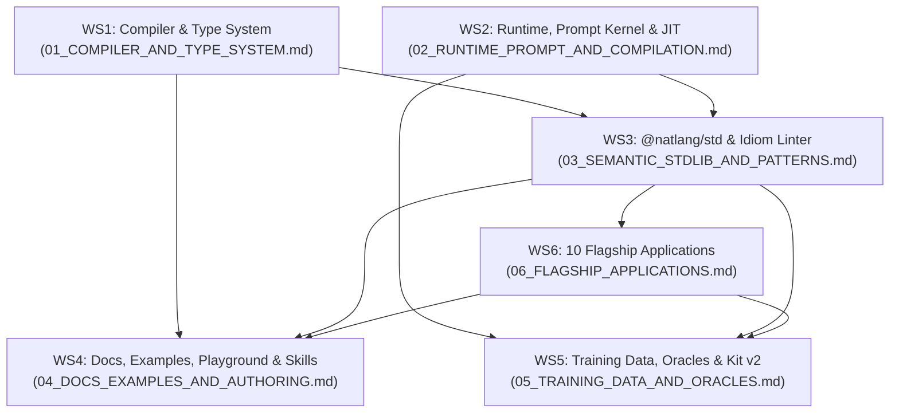

# Campaign: Realizing Semantic Functional Programming in natlang

**Created:** 2026-11-22  
**Status:** Active campaign plan  
**Scope:** Language semantics, compiler, runtime, standard library, documentation, examples, playground, training data/oracles, and flagship applications.

## 0. Complete Analysis & Reasoning

The full quantitative census, anti-pattern taxonomy, training-data breakdown, mental-model/runtime gap audit, and first-principles reasoning are documented in [00_AUDIT_AND_ANALYSIS.md](00_AUDIT_AND_ANALYSIS.md).

## 1. Thesis

Natlang's core bet is **typed semantic functional programming**: writing flexible, malleable, well-typed programs composed of semantically described functions (`nl` lambdas and `.nl` modules) embedded in structured TypeScript codebases — so people can automate repeat agentic work on **small, fast, cheap local models** (LFM3-1.7B) instead of burning frontier-model loops or maintaining brittle heuristic scripts.

A full audit of the repository (2026-11-22) established that **the runtime already holds much of this machinery**, yet the repo's examples, applications, docs, and training data do not inhabit the paradigm:

| Signal (2026-11-22 audit) | Observed in repo | What it means |
|---|---|---|
| Inline `` nl`...` `` in TS/JS | **4 / 712 files (0.56%)** | Semantic lambdas are treated as heavyweight RPC files, not first-class closures. |
| `nl.with(...)` in TS/JS | **0 / 712** *(27 prose in `.nl`)* | Explicit-capture semantic closures are effectively unused. |
| Higher-order `.nl` signatures (`=>`) | **0 / 2,062 `.nl` files (0%)** | Zero functions accept or return semantic lambdas despite contravariant lambda subtyping in `native/types.ts`. |
| Context rebinding `.in(ctx)` | **0** *(missing from `.d.nl.ts` types)* | Curried content-addressed contexts are completely invisible. |
| Companion dirs `.nl`-only vs mixed `.nl`+`.ts` | **88% `.nl`-only** in `applications/`; **92%** in `design_briefs/` | Bulk apps avoid executable TS helpers and write 200–779 word imperative algorithms in prose. |
| Bulk legacy prose trees | **1,711 / 2,062 `.nl` files (83%)** | `codebases/design_briefs/` (1,390) + 11 "Astra" apps (321) dominate repo discovery. |
| Browser playground (`ts-host/playground/examples/`) | **21/38 pure-TS LeetCode**, **13 legacy single-shot prompts** | First-time users see zero `readout: decision`, zero inline `nl`, zero `iterateOn`, zero `Is<T, P>`. |
| `grpo-pool` composition | **89.7%** legacy QA/puzzles/static codebase wrappers | Core constructs (`inline nl`, semantic `iterateOn`, `.in()`, `Is<T, P>`, `edit_code`) sit at **0–1%**. |
| Authored RL rounds 10–23 | Closed-set cue-word "operations desks" | Exact-match + literal Sonnet blind-solve purged real semantics in favor of keyword rules. |
| Universal system prompt (`native/prompt.ts`) | **~15.3 KB (~4,500 tokens)** | Defensive benchmark patches bloat every call and discourage compositional delegation. |

This repo drifted into **two opposite anti-patterns**:
1. **Timid front door** (`natlang init`, `website/`, `skills/`, playground): frames natlang as *"ordinary TypeScript with occasional narrow ticket classifiers."*
2. **Prose-as-slow-interpreter & cue-word desks** (bulk apps, RL authoring): replaces deterministic TypeScript with giant imperative English checklists or deterministic cue-word matching rules.

This campaign fixes **every layer of the stack together** so that genuine typed semantic functional programming is the easiest, fastest, best-documented, best-trained, and most compelling way to use natlang.

---

## 2. Campaign Architecture & Workstreams

| Workstream | Document | Core Outcome | Blocks Live Training? |
|---|---|---|---|
| **WS1** | [01_COMPILER_AND_TYPE_SYSTEM.md](01_COMPILER_AND_TYPE_SYSTEM.md) | Fix broken/missing types (`Is<T,P>` inline, `.in()`, `Folder`, tuples); add parametric generics, relational refinements, structural `.nl` recursion, real acyclic `uses:` imports, opt-in `edit_code`. | **No** (lands on main, picked up at next pin) |
| **WS2** | [02_RUNTIME_PROMPT_AND_COMPILATION.md](02_RUNTIME_PROMPT_AND_COMPILATION.md) | Slim 400-token modular system prompt; progressive codebase indexing; factorized `readout: decision` across all 4 engines + `escalate()`; unified `natlang profile` / `natlang compile` ladder. | **No** (prompt changes open a new scoring series at a resume; opt-out preserved) |
| **WS3** | [03_SEMANTIC_STDLIB_AND_PATTERNS.md](03_SEMANTIC_STDLIB_AND_PATTERNS.md) | `@natlang/std` polymorphic semantic combinators (`semanticFilter`, `semanticReduce`, `semanticMatch`, `semanticMerge`, `semanticRepair`, `compileRule`) + `natlang check --idiom` linter. | **No** |
| **WS4** | [04_DOCS_EXAMPLES_AND_AUTHORING.md](04_DOCS_EXAMPLES_AND_AUTHORING.md) | Overhaul `natlang init`, `README.md`, `website/`, playground gallery, and `skills/natlang-authoring/`; quarantine bulk synthetic prose trees (`design_briefs/`, Astra) from public discovery. | **No** |
| **WS5** | [05_TRAINING_DATA_AND_ORACLES.md](05_TRAINING_DATA_AND_ORACLES.md) | Break the cue-word trap with 4 new oracle classes (execution, metamorphic, proper-scoring, relational); wire real apps into `grpo-pool`; close 0% construct gaps; publish `RL_TASK_AUTHORING_KIT` v2. | **No** (new sources promote into `grpo-pool` via registry) |
| **WS6** | [06_FLAGSHIP_APPLICATIONS.md](06_FLAGSHIP_APPLICATIONS.md) | Ship 10 real repeat-agentic-work apps (`pr-shepherd`, `semantic-etl`, `sem-sheet`, `inbox-pilot`, `ci-doctor`, `sem-merge`, `runbook-engine`, `sem-grep-sql`, `codemod-studio`, `diligence`), profiled on LFM3-1.7B. | **No** (feeds live traces & evaluation cases back into WS5) |

---

## 3. Execution Waves & Sequencing

Training **never waits** on campaign coding (`AGENTS.md`: *"Coding and agent work never hold back training"*). Every wave ships behind crisp opt-out switches with targeted tests and enters training at the next pin/resume.

### Wave 0 — First-Principles Fixes (Shipped Directly on 2026-11-22)
Immediate bugs and contradictions verified in `ts-host` and fixed directly (see `ts-host/test/semantic-fp-fixes.test.mjs`):
1. ✅ Supported `Is<T, P>`, nested `Is`, `Untrusted<Is<T, P>>`, and object intersections `A & B` in inline `nl` (`compiler/targets.ts:166-200`), plus inline `refinedSlots` reporting (`compiler/project.ts:554-560`, `compiler/refined-slots.ts:28`).
2. ✅ Exposed `.in(context)` on `NatlangCallableMethods`, `InlineNatlangFunction`, and `NatlangUntypedFunction` (`compiler/intrinsics.ts`, `runtime/surface.ts`).
3. ✅ Fixed `Folder.apply` / `propose` / `iterateOn` TS types to accept crisp `(folder, ...args)` reducers and broadened `Folder.moveTo` / `FileHandle.moveTo` to `string | Folder | FileHandle` (`compiler/intrinsics.ts`, `native/scoped-fs.ts`).
4. ✅ Fixed the `persistentHelpers` factual contradiction in `native/prompt.ts:110` (`APPROACH_PROMPT`) vs `scope-compiler.ts:749-802`.
5. ✅ Replaced the banned `while (pending.size)` in `ts-host/playground/examples/crisp.mjs:114` with a bounded counted `for` loop (all `crispExamples` now pass `checkConstrainedSource`).

*(Remaining quick wiring: `RewriteGate` config in `natlang.json` moves into WS2 §5.)*

### Wave 1 — Front-Door & Authoring Reset (Week 1–2)
1. Ship `natlang check --idiom` linter (WS3) so coding agents get immediate feedback on anti-patterns.
2. Overhaul `natlang init`, `README.md`, `ts-host/playground/examples/`, and `skills/natlang-authoring/` (WS4).
3. Quarantine bulk synthetic corpora (`codebases/design_briefs/`, Astra apps) from public example discovery without breaking training/test paths (WS4).
4. Flip `edit_code` to opt-in (`mutable: true`, opt-out flag for legacy callers) (WS1).
5. Publish `RL_TASK_AUTHORING_KIT` v2 and launch first metamorphic + execution-oracle task batches (WS5).

### Wave 2 — Semantic FP Language & Prompt Kernel (Week 2–4)
1. Ship structural `.nl` recursion, tuple types, aliased/cross-package `uses:` v2, higher-order lambda runtime validation + relaxed `nl-not-called`, and parametric generics (WS1).
2. Ship relational `Is<T, P, { ... }>` / `ensures:` postconditions (WS1).
3. Ship the modular 400-token System Prompt Kernel + progressive codebase summaries (WS2, new scoring series, paired `held-v3` base re-measurement).
4. Ship `@natlang/std` combinators and `escalate()` (WS3, WS2).
5. Build Tier-1 flagship apps (`pr-shepherd`, `semantic-etl`, `sem-sheet`) to battle-test every primitive end-to-end (WS6).

### Wave 3 — Engine Parity, Progressive Compilation & Training Alignment (Week 4–8)
1. Ship factorized product-type `readout: decision` across all 4 engines (`docs/ENGINE_PARITY.md`: managed llama-server, wllama, Python native, SGLang actor) (WS2).
2. Ship unified `natlang profile` + `natlang compile` (specialize + tune + fuse) (WS2).
3. Wire SFT `readout: decision` soft-target supervision, inline-`nl` / semantic-`iterateOn` / `.in()` / `Is<T,P>` / `read_code`-discovery training families, and real flagship apps into `grpo-pool` and expert iteration (WS5).
4. Ship Tier-2 flagship apps (`inbox-pilot`, `ci-doctor`, `sem-merge`, `runbook-engine`), update `website/index.html` with interactive exhibits, and publish LFM3-1.7B vs frontier benchmark results (WS4, WS6).

### Wave 4 — Frontier Showcases & Held-v4 (Week 8+)
1. Ship Tier-3 flagship apps (`sem-grep-sql`, `codemod-studio`, `diligence`) (WS6).
2. Assemble `held-v4` covering the full semantic-FP surface (inline `nl`, higher-order combinators, structural `.nl` recursion, `.in()` rebinding, relational `Is<T, P>`, execution-grounded & metamorphic tasks) alongside `held-v3` continuity tracking (WS5).

---

## 4. Shared Mechanism & Engine-Parity Contract

Per `AGENTS.md` (*"Fix the mechanism everywhere it lives"*), every workstream carries an explicit mechanism inventory covering all components:

| Component | Owned Changes in This Campaign |
|---|---|
| `ts-host` compiler (`src/compiler/`) | Targets (`Is<T,P>`, `&`, tuples, generics), `intrinsics.ts` (`.in()`, `Folder`), `inline.ts` (factories, `untrusted-instruction`), `policy.ts` (`iteration-unbounded`, idiom lint), `project.ts` (compact `.d.nl.ts`, `RewriteGate`), `loader.ts` (`uses:` v2, `measure:`, `ensures:`, `mutable:`). |
| `ts-host` Node & Browser runtimes (`src/runtime/`, `src/native/`) | Structural `.nl` recursion (`kernel.ts`, `context.ts`), relational refinements (`refinement.ts`), lambda signature validation (`values.ts`), modular prompt kernel (`prompt.ts`, `system-prompts.ts`, `agent.ts`), progressive codebase index (`agent.ts`), factorized decisions (`decision.ts`, `decision-scoring.ts`), `escalate()`, `natlang profile`/`compile`. |
| Managed `llama-server` fork (`werg/llama.cpp-neuralese`) | Conditional/factorized KV-shared option scoring for product-type `readout: decision` (WS2). |
| In-page `wllama` (`ts-host/vendor/wllama`) | Same fork commit via `update_llama_runtime.mjs --fork`; browser playground runs full 12-example Semantic FP Progression (WS2, WS4). |
| Python native engine (`training/neuralese/.../serve/`) | Factorized decision scoring parity (`SCORE_ITEM_FIELDS` guarded by `test_engine_parity.py`); prompt rendering parity (`program-header` / modular kernel) (WS2). |
| SGLang actor (`serve/sglang_actor.py`) | Factorized decision scoring parity; `held-v3` / `held-v4` attestation on new prompt series (WS2, WS5). |
| Learner, collector & task pipeline (`training/`, `scripts/rl_tasks/`) | Four new oracle classes, `RL_TASK_AUTHORING_KIT` v2, SFT decision-readout soft targets, executable codebase tasks, anti-cue-word lint (WS5). |

---

## 5. Campaign Exit Criteria (What "Done" Looks Like)

1. **Language expressiveness:** Every example in `@natlang/std` and all Tier-1/Tier-2 flagship apps compile cleanly under `natlang check --idiom` with zero `any`, zero workarounds, and identical behavior on Node and browser (`wllama`).
2. **Authoring behavior:** Fresh coding agents briefed only with `natlang init`'s `AGENTS.md` + `skills/natlang-authoring/` naturally write mixed `.ts` + inline `nl` + `.nl` + `readout: decision` + `Is<T, P>` programs instead of 500-word `.nl` prose checklists or cue-word desks.
3. **Training-data alignment:** Every core semantic-FP construct (`inline nl`, semantic `iterateOn`, `.in()`, `Is<T, P>`, `read_code` discovery, higher-order lambdas, `readout: decision`, structural `.nl` recursion) has non-trivial, execution- or metamorphically verified share in `grpo-pool` and SFT.
4. **Small-model economic proof:** On at least 3 flagship repeat-agentic-work applications (`pr-shepherd`, `semantic-etl`, `inbox-pilot`), a compiled + tuned **LFM3-1.7B** pipeline (JIT specialization + `readout: decision` + confidence escalation) matches frontier-agent task quality at **≥ 10× lower cost and latency**.
