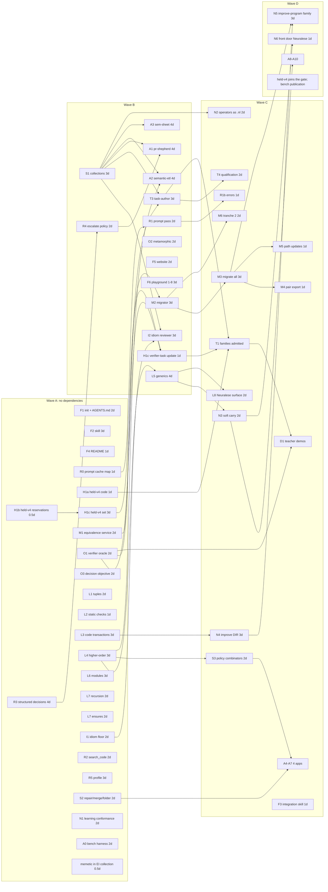

# Campaign: semantic functional programming in natlang (v2)

**Created:** 2026-11-22 (v1). **Rewritten:** 2026-11-23 (v2; DECISIONS 2026-11-23 "semantic-FP campaign v2").
**Status:** active. Work lands on main in parallel with training; no item holds training back.

## 1. Thesis

Natlang should be the obvious way to automate repeat agentic work: work that people hand to frontier agent loops
today, or fail to automate with brittle scripts. A natlang program has TypeScript types, data and exact steps. Every
judgment is a small typed natural-language function. It runs on a local LFM3-1.7B. Finite judgments are scored and
calibrated decisions, and only the unsure cases escalate. Results are checked against declared properties. Repeated
paths compile to 0-token crisp code. The program improves from its own runs, and its large values travel as
`Neuralese<T>` compressed state. The ambition is not parity with a frontier agent at lower cost. It is a compiled
local program that **beats** an unstructured frontier loop on quality for the work it was built for, and gets better
the longer it runs.

The audit ([00](00_AUDIT_AND_ANALYSIS.md)) found the runtime far ahead of everything around it:

| Signal (audit 2026-11-22, v2-corrected) | Observed | Meaning |
|---|---|---|
| Inline `nl` in TS/JS | 4 of 712 files | semantic lambdas are treated as heavyweight files |
| Higher-order `.nl` signatures, `.in(ctx)` | 0 | composition is invisible |
| Legacy prose corpora (`codebases/design_briefs/` + 11 Astra/Sol apps) | 1,711 of 2,062 `.nl` files | most of the repo shows plumbing written in English; it also ships 800+ exact behavioural cases to migrate against |
| Our own guidance | skill and generated AGENTS.md tell authors to "number the steps" of an algorithm with no policy/mechanism line | the front door taught the prose style |
| `grpo-pool` | 89.7% legacy QA/puzzles/wrappers; core constructs at 0-1% | training does not reach the paradigm |
| Authored RL rounds 10-23 | exact match + literal blind-solve selected cue-word desks | the oracle trained keyword rules |
| System prompt | 18,047 chars with task-specific patches; no `decide`; prose against re-delegation that the runtime already enforces | the prompt teaches in sentences what errors should teach |
| Neuralese, `natlang:learning`, memetic and program improvers | built; unreachable from what a consumer writes | product intent with no front door |

## 2. Workstreams

| WS | Document | Outcome |
|---|---|---|
| 1 | [01 Language](01_COMPILER_AND_TYPE_SYSTEM.md) | tuples; static termination and trust checks; malleable code through transactions (protected verifiers, adopt-call); checked higher-order lambdas; generics over `T \| Neuralese<T>`; cross-package `uses:`; structural `.nl` recursion; `ensures:` contracts; `Neuralese<T>` in the authoring surface |
| 2 | [02 Runtime](02_RUNTIME_PROMPT_AND_COMPILATION.md) | prompt judged after prefix caching: a byte-stable prefix pinned by a test; scar tissue, wrong forms and anti-delegation removed; `decide` described; errors that teach; `search_code`; structured decisions on all four engines; `escalate` as a natlang policy; `natlang profile` with a natlang "what next" policy |
| 3 | [03 Std and tools](03_SEMANTIC_STDLIB_AND_PATTERNS.md) | `@natlang/std` combinators with shipped `.nl` judgments, polymorphic over soft state; idiom review as a crisp floor in `natlang check` plus a natlang reviewer in `--idiom`; task authoring and qualification as a natlang program |
| 4 | [04 Front door](04_DOCS_EXAMPLES_AND_AUTHORING.md) | exact content for `natlang init`, its AGENTS.md, the authoring skill, README, website, playground progression and teaching errors. Shipped in Wave A |
| 5 | [05 Training](05_TRAINING_DATA_AND_ORACLES.md) | through expert iteration: verifier / metamorphic / proper-scoring oracles on existing mechanisms; construct families; teacher demonstrations of idiomatic programs; the decision objective in SFT; held-v4 first, held-v3 alongside |
| 6 | [06 Flagships](06_FLAGSHIP_APPLICATIONS.md) | Tier 0 = the campaign's own natlang tools; 10 repeat-work apps with beat-the-frontier, cost and crisp-share targets; self-improvement runs |
| 7 | [07 Corpus migration](07_CORPUS_MIGRATION.md) | 111 legacy programs migrated against their own cases by a natlang migrator, or deleted; every pair becomes training data |
| 8 | [08 Neuralese, memetic, self-improvement](08_NEURALESE_MEMETIC_SELF_IMPROVEMENT.md) | learned operators as `.nl` functions; soft-state carry through std; `natlang improve DIR` from a program's own runs; `grad` conformance; `improve-program` training family |
| — | [09 First execution batch](09_FIRST_BATCH.md) | dispatchable briefs, ordered by expected value |

## 3. Waves (dependency-ordered, sized in agent-days)

One agent-day is one agent session of ~6-8 h. Items in a wave run in parallel. An item starts the moment its
dependencies land; waves are labels, not gates. With ~12 agents in parallel, A-C take about a week of wall time and D
follows as its dependencies land.

**Critical paths.** Migration: M1 → M2 → M3 → M4 (~9 agent-days, wall time bound by collection on the program
cases). Language for Neuralese apps: L4 → L5 → N3 → A8-A10. Measurement: H1a/H1b/H1c run in Wave A with exact oracles; verifier-oracle
tasks join after O1; T1 admission waits only for those. held-v4 exists before any construct family is admitted.

**Training never waits.** Every item lands on main with an opt-out and targeted tests. The async round driver adopts
main at its next pin, so model-facing items (R1, R1b, L3 errors, L7 prompt sentence, O3) enter the running lineage at
its next round. Held measurement is paired across the series change with a warning (owner 2026-11-18 and
2026-11-22). It never blocks a model-facing fix.

## 4. Exit criteria

Each criterion is measured on held splits never trained on.
1. **Beat the frontier loop.** On at least 3 of the Tier 1-2 flagships, Arm D (compiled LFM3) beats Arm A (`gpt-6-luna`
   in an unstructured tool loop) on verifier pass rate, paired permutation p < 0.05, at ≤ 1/20 of its cost
   (WS6 §3-4). On the rest, Arm D is not significantly worse.
2. **Hot paths are code.** Steady state: semantic-etl serves ≥ 95% of rows from crisp cases, pr-shepherd ≥ 60% of
   hunks, and inbox-pilot ≥ 50% of messages, with `pluggable`-shadow agreement ≥ 0.98 where measured.
3. **The model learned the paradigm.** The current policy beats the base on held-v4 by ≥ 10 pts mean per-task pass
   rate (p < 0.05), with held-v3 not significantly worse than the policy it started from.
4. **Programs improve themselves.** `natlang improve DIR` raises confirmation-split pass rate ≥ 5 pts on ≥ 3
   flagships, with no human edits and no app made worse (WS6 §5).
5. **The front door produces idiomatic programs.** The blind authoring check (WS4 §10) passes ≥ 4 of 5, and the
   generated `natlang init` program runs its first call in under ~60 s on local CPU.
6. **The repo shows only the paradigm.** All 111 legacy programs are migrated or deleted. The `.nl` census (00 §2) is
   re-run, and the idiom floor reports 0 warnings on `examples/`, `applications/` and `codebases/`.
7. **The campaign's tools run on the paradigm.** The idiom reviewer, migrator and task author meet their Tier 0
   targets (WS6 §2), with LFM3 running their calls wherever it can.
8. **Neuralese is on.** A trained compaction operator beats shuffled, zeroed and text-cut on held-v4's Neuralese
   stratum. `compaction: 'nl'` becomes the default (FALLOW C7, WS8 §4).

## 5. Shared contract for every item

- **Mechanism inventory first** (AGENTS.md "Fix the mechanism everywhere it lives"). Each item's brief carries the
  inventory, or makes building it the first step: every engine (managed llama-server, wllama, Python native, SGLang
  actor), the ts-host runtime (Node and browser), compiler, learner, held eval, collectors, renderers of recorded
  prompts. A component left out cites the code showing it does not use the mechanism. For engines only a current
  blocker counts (`docs/ENGINE_PARITY.md` row).
- **Natlang-native.** A component that decides is a natlang program (`.nl` stages plus crisp helpers;
  `pluggable({ crisp, nl })` where it is hot). DECOMPOSITION.md is written first, then the program is implemented and
  merged.
- **Model-facing changes** ship as the default on first principles, recorded in `plans/MODEL_FACING_CHANGES.md`. The
  system message and tool block stay a byte-stable prefix (`prompt-prefix-stability.test.mjs`, WS2 R0).
- **Teach in errors.** No wrong form in any prompt or front-door text. Every new error has a one-sentence fix in the
  authoring skill's table and a row in `spec/ERRORS.md`.
- **Data custody.** New corpora are registered (`data_registry.py`), promoted by role, verified against held-v3 and
  held-v4 (`held_eval verify`), and measured for repetition before admission.
- **Git.** Main only. `git commit -m ... -- PATHS`. `scripts/check-main.sh --quick` passes under the memory ledger
  before every push. DECISIONS.md gets an entry for each decision.

## 6. Changes from v1

| v1 | v2 | Why |
|---|---|---|
| Week 1-2 … Week 8+ | dependency-ordered waves A-D sized in agent-days; every item an agent can execute from its text (files, inventory, tests, done criteria); first batch of briefs in [09](09_FIRST_BATCH.md) | agents work in parallel in hours to days |
| quarantine 1,711 legacy `.nl` files | migrate each against its own exact cases with a natlang migrator, or delete it; pairs become refactor tasks, idiomatic-program tasks and teacher demonstrations (WS7) | the corpora ship 800 exact cases plus fixture verifiers; quarantine keeps the wrong style and wastes them |
| crisp idiom linter with keyword heuristics; migrator, task authoring, qualification and escalation outside the paradigm | crisp floor only for exact facts; the semantic review, migration, task authoring, qualification and escalation are natlang programs on LFM3, Tier 0 flagships | they decide; AGENTS.md's main rule; the repo already has the pattern (specializer, migration, program-improver) |
| "~400-token kernel", ≤ 600-token gate, per-call capability modules | prompt judged after prefix caching; byte-stable prefix pinned by a test; sentence-level pass removing scar tissue, wrong forms and anti-delegation; `decide` described; gating only where it teaches better or saves after caching (WS2 R0-R1) | every engine and the learner reuse the stable prefix; raw tokens are the wrong measure, and per-call assembly fragments the cache |
| GRPO-first pool with target shares; held-v4 in "Wave 4" | expert-iteration entry points named; oracles built on `trusted_exact_verifier`; existing decision objective wired into `exp0_sft`; frontier-allocated families; teacher demonstrations via `teacher_gen.py` (Luna, Sol, Haiku, free endpoints); held-v4 code and reservations in Wave A | that is the training that runs; measure what we want before training on it |
| Neuralese as one WS5 row | WS8: operators as `.nl` functions, soft-state carry through std, `natlang improve DIR`, `grad` conformance, `improve-program` family | core product intent (AGENTS.md) |
| `edit_code` opt-in | `edit_code` stays on where a call owns code. Verifiers are protected, and good edits are proposals adopted through a Folder transaction (`natlang improve adopt-call`) | malleability is the thesis; the defects were self-judging edits and lost fixes. *(Fact: edit_code was never on for every call)* |
| "parity at ≥ 10× lower cost" | beat an unstructured frontier loop on quality at ≤ 1/20 cost; crisp-share targets per flagship; self-improvement and held-v4 targets | owner direction (point 8) |
| front door in Waves 1-3, with an anti-pattern gallery | exact `natlang init` files, generated AGENTS.md, skill sections and README opening written into WS4, shipped in Wave A; no wrong forms shown, errors teach them | consumers learn from what they read first |
| — | new: R0 prefix-break check (`edit_code`/`diff_code` added conditionally to the tool block); SFT render-vs-sample check; decision objective unwired; memetic share forced to 0 in EI collection; `sol_programs.json` unused; `natlang improve` needs a hand-written CASE.json; `grad` conformance pending | found while verifying v1 (point 10) |

v1's factual errors, corrected in place: `edit_code` is gated on own code and already has opt-outs. APPROACH_PROMPT
is not sent at runtime. TS-only playground examples are test fixtures, not gallery entries. `uses:` takes
package-root paths. `nl-not-called` rejects only arrows passed as call arguments. `natlang specialize` is an alias of
`compilations`. `natlang improve` exists.
